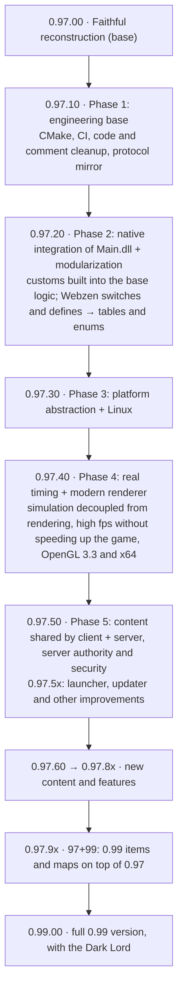
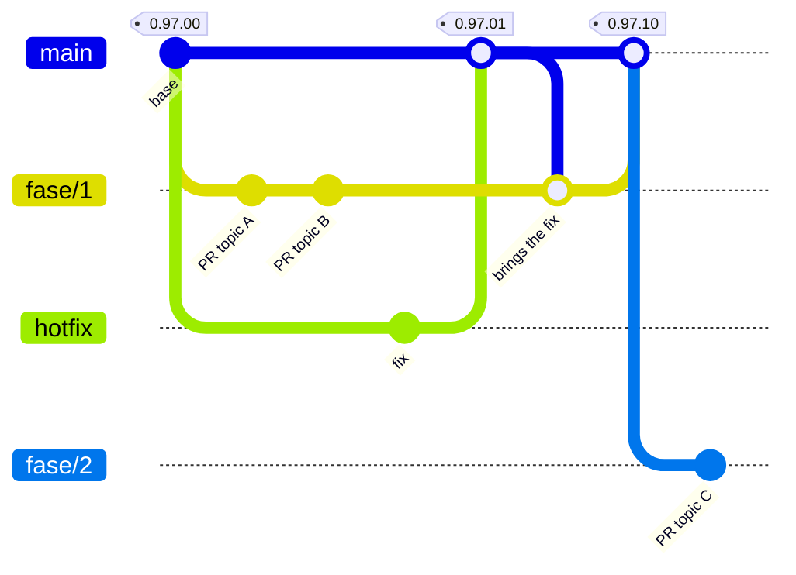

# Mu Online 0.97k — source code reconstruction

[](https://mu-linux.com/es/)

[🇪🇸 Español](README.md) | 🇺🇸 English | [🇧🇷 Português](README.pt-BR.md)

C++ port of the **Mu Online 0.97k** client (`main.exe`, MD5
`eb95ac0785e40a7ad60c9ddb5d8bef34`), reconstructed by reverse engineering the
original binary.

The compiled client **behaves like the original binary**: same login flow, same
rendering, same packets. It is not a rewrite or a client "inspired by": every
function is a port of its counterpart in the binary, and deliberate deviations
are documented in a comment next to the code.

On top of that base, the features of the `Main.dll` injection DLL were
integrated (Phase 2) and Linux support was added (Phase 3).

---

## Status

**The reconstruction is complete.** No function of the binary is left unported.
A latent bug may still show up when a rarely used path is exercised, and it gets
fixed by comparing against IDA, but the reverse-engineering base is finished
(tag `0.97.00`).

The client starts, connects, logs in, picks a character, enters the world and is
playable: terrain, characters, NPCs and monsters, inventory, equipment, shop,
vault, trade, chat, party, guild, combat, skills, effects, events, sound and
music.

| Platform | Backend | Status |
|---|---|---|
| Windows x86 | Win32 (the original binary's) | Complete |
| Windows x86 | SDL3 | Complete |
| Linux x86 | SDL3 | Complete; with NVIDIA, prefer X11 (see [Wayland and NVIDIA GPUs](#wayland-and-nvidia-gpus)) |

---

## What you need

- **The assets are already included** in `bin/Client/Data/` (~209 MB: `.bmd`
  models, `.ozj`/`.ozt` textures, maps, sounds and music). Clone, build, run.
- **A server.** The port is validated against
  [MuEmu - Linux](https://github.com/EmanuelCatania/Mu-Linux-0.97k) (season
  0.97k), which is the authoritative source for the packet format. The Windows
  version, [MuEmu - Kayito](https://github.com/nicomuratona/MuEmu-0.97k-kayito),
  works too. Each client Release states which server version it works with.

---

## Building

There are two platform backends, selected with `MU_PLATFORM_BACKEND`:

- **`Win32`** (the default): window, input, sound and network through the
  Windows API, like the original binary. Windows only.
- **`SDL3`**: the same on top of SDL3, FreeType and miniaudio. Windows and Linux.

**It is always x86 (32-bit).** The port assumes 32-bit pointers: the original
binary's addresses, struct layouts and memory pools. CMake stops the
configuration if you try to build for 64 bits.

### Windows (Win32 backend)

Requires **Visual Studio 2022** with the C++ desktop toolset (it ships CMake).
There are two equivalent ways, and both produce the same exe:

- **Visual Studio:** open `mu97k.sln`, pick **Debug** or **Release** with the
  **Win32** platform, and build.
- **CMake:**
  ```
  cmake -S . -B build -A Win32 -T v143
  cmake --build build --config Release
  ```
  The first command also generates `build/mu97k.sln`, in case you want to keep
  working in Visual Studio with the `src/` folders shown as filters.

Output: `bin/Client/main.exe` (plus `main.map` to resolve crash stacks). The
project links straight into `bin/Client/`, which is where the assets and
`Config.ini` live, so there is no intermediate copy and no risk of running a
stale binary.

### Windows (SDL3 backend)

Same requirements, plus an internet connection the first time you configure:
SDL3, FreeType and miniaudio are downloaded with `FetchContent` at pinned
versions.

```
cmake -S . -B build-sdl3 -A Win32 -T v143 -DMU_PLATFORM_BACKEND=SDL3
cmake --build build-sdl3 --config Release
```

The output is also `bin/Client/main.exe`, so it overwrites the Win32 one.

### Linux x86 (SDL3 backend)

You need Git, CMake 3.25+, Ninja, Python 3, pkg-config and GCC/G++ with `-m32`
support, plus the **32-bit** development libraries (also on an x64 Linux):

- **Arch** (with `[multilib]` enabled):
  `base-devel gcc cmake ninja git python pkgconf glu wayland-protocols`, plus the
  `lib32-*` libraries from [Running on Linux](#running-on-linux), which already
  include the development files.
- **Debian/Ubuntu:** `g++-multilib libc6-dev-i386 cmake ninja-build git python3
  pkg-config wayland-protocols libx11-dev:i386 libxext-dev:i386
  libxrandr-dev:i386 libxinerama-dev:i386 libxcursor-dev:i386 libxi-dev:i386
  libgl1-mesa-dev:i386 libglu1-mesa-dev:i386 libwayland-dev:i386
  libxkbcommon-dev:i386 libdecor-0-dev:i386 libasound2-dev:i386
  libpulse-dev:i386`. Ubuntu 22.04 ships CMake 3.22: install CMake 3.25+ before
  configuring (for example, in a Python virtual environment).
- **Fedora:** `gcc gcc-c++ cmake ninja-build git python3 pkgconf-pkg-config
  wayland-devel wayland-protocols-devel glibc-devel.i686 libstdc++-devel.i686
  mesa-libGLU-devel.i686 libglvnd-devel.i686 libX11-devel.i686
  libXext-devel.i686 libXrandr-devel.i686 libXinerama-devel.i686
  libXcursor-devel.i686 libXi-devel.i686 wayland-devel.i686
  libxkbcommon-devel.i686 libdecor-devel.i686 alsa-lib-devel.i686
  pulseaudio-libs-devel.i686`.

```sh
# PKG_CONFIG_LIBDIR must point at the 32-bit libraries.
export PKG_CONFIG_LIBDIR=/usr/lib32/pkgconfig:/usr/share/pkgconfig                      # Arch
# export PKG_CONFIG_LIBDIR=/usr/lib/i386-linux-gnu/pkgconfig:/usr/share/pkgconfig        # Debian / Ubuntu
# export PKG_CONFIG_LIBDIR=/usr/lib/pkgconfig:/usr/share/pkgconfig                      # Fedora

cmake -S . -B build/linux-release -G Ninja \
  -DCMAKE_TOOLCHAIN_FILE=cmake/toolchains/linux-x86.cmake \
  -DMU_PLATFORM_BACKEND=SDL3 -DMU_PLATFORM_ONLY=OFF -DCMAKE_BUILD_TYPE=Release
cmake --build build/linux-release --parallel 4
```

The executable ends up in `build/linux-release/bin/main` (not in `bin/Client/`,
so it does not mix with the Windows one). To run it against the repo's assets,
point `MU_ASSET_ROOT` at `bin/Client` (see [Running on Linux](#running-on-linux)).

### For contributors

- While the `.sln` and CMake coexist, a new `.cpp` goes into the `.vcxproj`
  **and** into `CMakeLists.txt`. CI fails if the two lists don't match; you can
  check locally with `python .github/scripts/check_cmake_sources.py`.
- Dependencies bundled in the repo: `lib/stb` (decodes the `.ozj`/`.ozt`
  textures and saves screenshots) and `lib/miniaudio` (music). SDL3 adds SDL3
  and FreeType, downloaded at configure time.
- CI builds the three combinations (Windows Win32, Windows SDL3 and Linux SDL3)
  in Debug and Release, and packages the Linux Release.

---

## Configuring and playing

### Pointing it at your server

The server address and identity are **compiled into the client**, as in MU 5.2:
there is no config file to ship. They live in `src/Config/ServerConfig.h` and
point to the project's reference server; to use yours, edit that file and
rebuild.

The address can be an IP or a host name (the client resolves it through DNS,
like the original). A name is better: no public IP is hardcoded and the server
can move without a rebuild. If the domain is on Cloudflare, the record must be
**unproxied** ("DNS only"): the proxy only lets web traffic through and cuts the
game connections.

```cpp
constexpr char           ConnectServerIP[]   = "mu.server-pups.space";
constexpr unsigned short ConnectServerPort   = 44405;   // 0 = no ConnectServer
constexpr char           GameServerIP[]      = "mu.server-pups.space";
constexpr unsigned short GameServerPort      = 55901;
constexpr char           CustomerName[]      = "MuLinux";
constexpr char           ServerSerial[]      = "TbYehR2hFUPBKgZj";
constexpr char           ClientVersion[]     = "0.97.11";
```

**Addresses.** With a non-zero `ConnectServerPort` the ConnectServer flow is
used: the client requests the real list (`F4/02`), the server answers with names
and load, and picking one sends `F4/03`, which redirects to the GameServer; if
the ConnectServer does not answer, it connects to the GameServer. With `0` it
connects straight to the GameServer and the server-select shows a fixed entry.

> The server-select **always** shows up, even when pointing straight at the
> GameServer: it is a screen of the original flow, not a sign that you are
> reaching the ConnectServer.

**Server identity.** All three values must match the GameServer's
(`MuServer/GameServer/DATA/GameServerInfo - StartUp.dat`). If any of them does
not match, the client **connects but never gets in**, with no useful message:

| Value | Where it comes from | What happens if it doesn't match |
|---|---|---|
| `CustomerName` | `CustomerName=` in the `.dat` | The client connects, decrypts garbage and hangs on *"connecting to the GameServer"* forever |
| `ServerSerial` | `ServerSerial=` in the `.dat` | Same as above, **and** the login returns *"wrong version"* |
| `ClientVersion` | `ServerVersion=` in the `.dat` | Login rejected with *"wrong version"* |

`CustomerName` and `ServerSerial` feed the encryption key, which the GameServer
derives from both combined (`GameServer/HackCheck.cpp::InitHackCheck`).
`ServerSerial` does double duty: it goes into that derivation and the server
also compares it byte by byte at login. `ClientVersion` accepts `0.97.11` or
`09711`.

**To troubleshoot**, `debug.log` records the address in use and the derived key
at startup:

```
ServerConfig: ConnectServer=mu.server-pups.space:44405 GameServer=mu.server-pups.space:55901 version='09711'
MuEmu: InitKeys CustomerName='MuLinux' Serial='TbYehR2hFUPBKgZj' -> EncDecKey1=0xC2 EncDecKey2=0x01 (xor=0xC2 add=0xC2)
```

If the client hangs while connecting, that line is the first thing to check:
compare it with the server's `CustomerName`.

### Player options

Preferences are read from **`Config.ini`**, with the same sections and keys the
`Main.dll` injection DLL used, so the `Config.ini` you already have works. On
Windows it is `bin/Client/Config.ini`; on Linux, `~/.local/share/mu97k/Config.ini`.
Most of them can also be changed from the in-game options menu, which saves them
to the same file.

On Windows, if a key is missing from `Config.ini` the registry wins (where the
original 0.97k kept what the official launcher configured) and, if it is not
there either, the binary's default. What was applied is logged to `debug.log`
(`Config.ini: ...` line).

| Key | Default | Notes |
|---|---|---|
| `[Window] WindowMode` | — (deviation) | `1` = windowed, `0` = fullscreen. The 0.97k only runs fullscreen and looks for a 16-bit video mode that does not exist on Windows 10/11. |
| `[Window] Borderless` | — (deviation) | `1` = no title bar or border. Windowed mode only. |
| `[Window] Resolution` | `0` (640x480) | DLL indices: `0` 640x480, `1` 800x600, `2` 1024x768, `3` 1280x1024, `4` 1280x720, `5` 1366x768, `6` 1600x900, `7` 1920x1080. Note: `4` is not the registry's `4` (there it is 1600x1200). |
| `[Sound] EnableSound` | `1` | Sound effects. |
| `[Sound] EnableMusic` | `0` (off) | The repo's `Config.ini` ships it as `1`. The login theme is `Data\Music\MuTheme.mp3`, which the pack does not include (as in the original). |
| `[Sound] SoundLevel`, `MusicLevel` | — (deviation) | Volume from `0` (muted) to `9` (original volume); like the DLL, each level is 6.25 dB. |
| `[User] Username` | — | Prefills the login username field. |
| `[Language] LangSelection` | — (`Text.bmd`, which here is the Spanish variant) | Interface language: `Eng`, `Spn` or `Por`. Picks among the `Text_*.bmd` and `Dialog_*.bmd` in `Data/Local/`. Item, skill and quest names are in English and have no variant. |
| `[MiniMap] Alpha`, `ZoomLevel` | `10`, `0` | Minimap transparency (`3` to `10`) and zoom (`0` to `6`). |
| `[Antilag] Delete…` | `0` | Turn off parts of the rendering for slow machines: `DeleteShadows`, `DeleteObjects`, `DeleteFloor`, `DeleteSkills`, `DeleteStaticEffects`, `DeleteDynamicEffects`, `DeleteWings`, `DeleteHealthBar`, `DeleteInterface`, `DeleteWeather`, `DeleteGlow`. |
| `[Font] FontName`, `FontHeight`, `FontBold`, `FontItalic`, `FontCharset`, `FontWidth`, `FontUnderline`, `FontQuality`, `FontStrikeOut` | Arial, height by resolution | Like the DLL: fixed height (capped at 25) and the big font at twice the size. The repo's `Config.ini` ships Verdana 13. If the whole `[Font]` section is removed, the client goes back to the original font. |

### Running on Windows

Run `bin/Client/main.exe`.

### Running on Linux

CI packages the Linux client (artifact `mu97k-linux-release`: the `.tar.gz`, its
SHA256 and the library inventory). It contains `main`, `Data`, licenses, README
and `launch.sh`; it does not carry the developer's `Config.ini`.

The executable is **ELF32 with SSE2**, built on Ubuntu 22.04 (it uses no glibc
symbols newer than 2.35). SDL3, FreeType and miniaudio are linked statically;
OpenGL, glibc and the desktop libraries come from the system and must be
**32-bit**, even on an x64 Linux:

```sh
# Arch ([multilib] enabled)
sudo pacman -S --needed lib32-glibc lib32-gcc-libs lib32-glu lib32-libglvnd \
  lib32-libx11 lib32-libxext lib32-libxrandr lib32-libxcursor lib32-libxi \
  lib32-wayland lib32-libxkbcommon lib32-libdecor lib32-alsa-lib lib32-libpulse
# Intel/AMD: lib32-mesa. NVIDIA: lib32-nvidia-utils matching the installed driver.

# Debian 12 / Ubuntu 22.04+
sudo dpkg --add-architecture i386
sudo apt-get update
sudo apt-get install libc6:i386 libstdc++6:i386 libgcc-s1:i386 \
  libglu1-mesa:i386 libgl1:i386 libegl1:i386 libgl1-mesa-dri:i386 \
  libx11-6:i386 libxext6:i386 libxrandr2:i386 libxcursor1:i386 libxi6:i386 \
  libwayland-client0:i386 libwayland-cursor0:i386 libwayland-egl1:i386 \
  libxkbcommon0:i386 libdecor-0-0:i386 libdecor-0-plugin-1-cairo:i386 libpulse0:i386
# ALSA: libasound2:i386 (Debian 12 / Ubuntu 22.04), libasound2t64:i386 (Ubuntu 24.04+).

# Fedora
sudo dnf install glibc.i686 libstdc++.i686 libgcc.i686 mesa-libGLU.i686 \
  libglvnd-glx.i686 libglvnd-egl.i686 mesa-dri-drivers.i686 \
  libX11.i686 libXext.i686 libXrandr.i686 libXcursor.i686 libXi.i686 \
  wayland.i686 libxkbcommon.i686 libdecor.i686 alsa-lib.i686 pulseaudio-libs.i686
```

Extract the `.tar.gz` on a Linux partition (on NTFS the executable permissions
are lost) and run `./launch.sh` from a terminal, without sudo. Configuration,
screenshots and `debug.log` are saved in
`${XDG_DATA_HOME:-$HOME/.local/share}/mu97k`; `MU_CLIENT_ROOT` lets you pick
another directory. The first run creates a windowed 1024×768 configuration and
never overwrites existing preferences.

To read the assets from another folder without copying them (for example, an
NTFS disk or the repo's `bin/Client`), point `MU_ASSET_ROOT` at the folder **that
contains `Data`**:

```sh
MU_ASSET_ROOT='/run/media/user/HDD/path/Client' ./launch.sh
```

Without `SDL_VIDEODRIVER`, a Wayland session tries Wayland and then
X11/XWayland; the chosen backend and the OpenGL renderer are printed to stderr at
startup (`Backend de video: …` and `OpenGL: vendor | renderer | versión`). To
force one: `SDL_VIDEODRIVER=x11 ./launch.sh` or `SDL_VIDEODRIVER=wayland
./launch.sh`.

Other Linux details:

- `lib32-libdecor` provides client-side window decorations. Without it, a
  compositor that does not decorate server-side may show the window without a
  frame.
- On HiDPI the game's logical resolution is kept and the compositor scales the
  image, which may look less sharp.
- The IME uses SDL/Wayland text input, limited to the game's Windows-1252
  repertoire; it does not show the Windows IMM indicator.
- Screenshots are taken with **Print Screen**. On KDE, Spectacle grabs the key
  before it reaches the game.

### Wayland and NVIDIA GPUs

The client is 32-bit, and with NVIDIA that has two consequences on native
Wayland (found on Arch, KDE Plasma, RTX 3080 Ti, driver 615):

- **Without the 32-bit EGL Wayland platform, Wayland renders in software.**
  NVIDIA only ships `egl-wayland` for x64. Without `libnvidia-egl-wayland.so.1`
  in `/usr/lib32`, the Wayland GL context falls back to Mesa `llvmpipe`: 24 fps,
  skill effects as white quads and transparent blacks. The client detects it at
  startup (`Renderer por software en wayland`) and switches to X11/XWayland on
  its own, where GLX does use the GPU.
- **With that platform installed, native Wayland works but performs much
  worse.** NVIDIA's 32-bit EGL driver resolves thread-local variables with
  `__tls_get_addr` on every GL call, and the client draws in immediate mode
  (`glVertex`/`glTexCoord` per vertex, like the 0.97k). Measured at the same spot
  in the game: 4.7 ms per frame with X11/GLX versus 70-85 ms with Wayland/EGL,
  i.e. 25 fps versus 11-17. `__GL_SYNC_TO_VBLANK` and `__GL_MaxFramesAllowed` do
  not change it. It cannot be fixed from the client: it goes away with the modern
  renderer or the move to x64 on the roadmap.

In the second case the client does **not** fall back to X11 on its own, because
the renderer is accelerated. **With NVIDIA, run the client on X11:**

```sh
SDL_VIDEODRIVER=x11 ./launch.sh
```

Native Wayland is for GPUs with Mesa (Intel/AMD), whose 32-bit EGL does not have
this problem.

32-bit `egl-wayland` is not in Arch's official repositories. The AUR
`lib32-egl-wayland` package is usually behind and requires the same version as
`egl-wayland`; installing it with a helper can downgrade the 64-bit one. If you
want it for testing, build the PKGBUILD with `pkgver` set to your `egl-wayland`
version, and rebuild it every time you update the driver.

---

## How to add custom items

With the injected `Main.dll`, a custom item had to be added on both sides: the
server defined it in its `Item.txt`, and the client needed a regenerated
`item.bmd` plus the `Encoder` `.txt` files (`CustomItem.txt`, `CustomGlow.txt`,
etc.) packed into `ClientInfo.bmd`. If client and server disagreed, the item
rendered wrong or the server rejected it.

Now **the server is the only source**. On login it sends the client a catalog
with every definition (items, monsters, effects, pets). The client **only needs
the model files** (`.bmd` and textures) under `bin/Client/Data`. No `item.bmd`
to regenerate and no code to touch.

The DLL's `Encoder` `.txt` files are still read from the server's
`Data/Custom/Encoder`, so a customs folder built for the DLL works without
converting anything.

### Indexes: the classic range and the extended one

In 0.97k every item section (swords, axes, …, jewels) has **32 indexes** (0 to
31). On top of that, every section accepts indexes **32 to 511**: those are the
*added* items. On the wire they use 13 bits (an item is 7 bytes instead of 5),
so they never collide with a vanilla item.

An added item has to say **which vanilla item it behaves like** (the *Behavior*
column): that drives the logic 0.97k hardcodes per item type (whether it is a
bow and uses arrows, whether it is a wing, a jewel, which excellent options it
can roll). Everything else —name, stats, size, model, glow, effects— comes from
its own row.

### Example 1: the Knight Blade, the DLL way

The item sits inside the classic range (`0,20`); model and glow are defined in
the `Encoder`:

```
// Data/Custom/Encoder/CustomItem.txt
00,020		22		"Sword21"		// Knight Blade

// Data/Custom/Encoder/CustomGlow.txt
00,020		191	165	127		// Knight Blade
```

Client assets: `bin/Client/Data/Item/Custom/20/` (`sword21.bmd` and its
textures).

### Example 2: the Crimson Knight Blade, outside the classic range

The same model as an added item (`0,32`), all in one row of
`Data/Item/Item.txt`. After the usual columns come: behavior, model folder and
name, and the glow color (RGB):

```
32	0	22	1	4	1	1	0	"Crimson Knight Blade"	...	00,020	"Item\Custom\20\"	"Sword21"	255	40	40
```

It behaves like the Knight Blade (`00,020`), uses the `Sword21` model and glows
red. Test command: `/make 0 32`.

### Example 3: the Great Dragon set

Five pieces at index `21` of sections 7 to 11, with the model defined in the
`Encoder`'s `CustomItem.txt` (as with the DLL):

```
07,021		0		"HelmMale22"		// Great Dragon Helm
08,021		0		"ArmorMale22"		// Great Dragon Armor
09,021		0		"PantMale22"		// Great Dragon Pant
10,021		0		"GloveMale22"		// Great Dragon Glove
11,021		0		"BootMale22"		// Great Dragon Boot
```

Client assets: `bin/Client/Data/Player/Custom/21/`. The same pieces can also be
defined without the `Encoder`, with the model columns in `Item.txt`
(`"Player\Custom\21\" "HelmMale22"`).

### Example 4: custom effects and inventory pose

`Data/Custom/Items/<section>_<index>.json` gives an item (custom or vanilla) its
inventory pose and effects the client draws on the model's bones. For example,
wings with the sparkles of the 5.2 Wings of Illusion:

```json
{
  "item": "12,032",
  "effects": [
    { "on": "equipped", "type": "sprite", "texture": "Effect/Flare.jpg",
      "bones": [5, 6, 7, 8, 18, 19], "color": [0.5, 0.0, 0.0], "scale": 0.6,
      "pulse": { "speed": 0.002, "scale": 0.2, "color": 0.4 } },
    { "on": "equipped", "type": "particle", "particle": 1230,
      "bones": [13, 31], "chance": 2, "color": [0.8, 0.8, 0.3], "scale": 0.5 }
  ]
}
```

The server repo has a real case: `Data/Custom/Items/03_000.json` fixes the
position of the (vanilla) Light Spear in its inventory cell, using the 5.2
correction.

### Example 5: a custom pet (Pet Rudolph)

The 5.2 Rudolph as a pet that circles the player and picks up nearby zen. It
uses a high index (`13,400`) on purpose, to show off the extended range. Four
files, all included in the repos:

| Where | File | What it defines |
|---|---|---|
| client | `bin/Client/Data/Item/Custom/Rudolph/` | the `xmas_deer.bmd` model and its textures |
| server | `Data/Item/Item.txt` | the item row: `Slot` 8 (helper), behavior `*` (it does not mimic any vanilla pet) and the model |
| server | `Data/Custom/Items/13_400.json` | the inventory pose |
| server | `Data/Custom/Pets/13_400.json` | how it moves and what it does |

```json
{
  "item": "13,400",
  "blendMesh": 0,
  "movement": { "type": "orbit", "radius": 50, "period": 4000, "height": 20 },
  "abilities": [ { "type": "pickup", "what": "zen", "range": 3, "interval": 1000, "delay": 1500 } ]
}
```

The client draws the movement; the abilities (picking up zen) are run by the
server, which is the one that decides. Test command: `/make 13 400`.

### Example 6: a custom monster (Karane)

The DLL way, with `Data/Custom/Encoder/CustomMonster.txt` (index, type
`0`=NPC `1`=monster, golden, scale, folder and model):

```
152		1		1		2.0		"Monster\\Karane\\"		"Karane"		// Karane
```

Or directly in `Data/Monster/Monster.txt`, with the same columns at the end of
the monster's row:

```
152	0	"Karane"	...	0	0	1	1	2.0	"Monster\Karane\"	"Karane"
```

Client assets: `bin/Client/Data/Monster/Karane/`.

### Reference

Optional columns at the end of each `Item.txt` row (`*` = no value):

| Column | Example | What it does |
|---|---|---|
| Behavior | `00,020` | vanilla item it behaves like |
| Model folder and name | `"Item\Custom\20\" "Sword21"` | model in the inventory, on the ground and on the character |
| Glow | `255 40 40` | per-level glow color |
| Worn model folder and name | `"Item\Custom\FenrirMount\" "fenril_black"` | only if the item looks different when worn (a mount) |
| Gate | `22` | for scrolls: always takes you to that gate |

`Data/Custom/Items` JSON files also accept `"tooltip"`: up to 6 extra lines
below the item name, as plain text (`"Zen picker"`) or with a color
(`{ "text": "Zen picker", "color": "gold" }`; colors: `white`, `blue`, `red`,
`gold`, `green`, `darkred`, `purple`, `darkblue`, `darkgold`).

For custom wings, `Data/Item/CustomWing.txt` adds the defense and damage
constants. The `Data/Custom/Items` and `Data/Custom/Pets` JSON files are
validated when the server starts: a file with errors is dropped whole and the
reason goes to `GameServer/LOG`.

---

## Layout

```
mu97k-src/
├── mu97k.sln            VS2022 solution (Win32 backend)
├── mu97k.vcxproj        project (Win32)
├── CMakeLists.txt       build for the three combinations (Win32, SDL3 Windows, SDL3 Linux)
├── cmake/               CMake modules and the Linux x86 toolchain
├── lib/stb/             decodes the .ozj/.ozt textures and saves screenshots
├── lib/miniaudio/       plays the music
└── src/
    ├── WinMain.cpp      entry point + message loop
    ├── Platform/        platform interfaces and their backends (Win32/, SDL3/, Posix/)
    ├── globals.{h,cpp}  global state; identified DATs keep their IDA traceability
    ├── functions.h      shared declarations and the IDA origin of renamed symbols
    ├── structs.h        struct layouts verified against IDA
    ├── ghidra_compat.h  macros the decompiler takes for granted (qmemcpy, LODWORD, ...)
    │
    ├── Combat/  Config/  Core/    Entity/  Game/     GameGuard/ Input/ Item/
    ├── Local/   Math/    Model/   Monster/ Net/       Party/     Path/  Physics/
    └── Render/  Scene/   Sound/   Terrain/ Trade/     UI/        Util/
```

Modules are grouped by responsibility. The address in the binary is still an
important clue to verify a function or resolve a symbol, but it does not decide
where the ported code lives.

---

## Roadmap

Each `XX.XX.00` version matches a Webzen version: `0.97.00` is 0.97k, `0.99.00`
will be 0.99, and so on with each Season. The tags in between are the path to
the next version.

### The 0.97 line

Tag `0.97.00` closes the faithful reconstruction: the client behaves like the
original binary. On top of that base, the 0.97 line is worked in engineering
phases; each closed phase is a version.



Each phase's number is the version planned when it closes; the scope of each one
may be adjusted along the way.

### After 0.97

Engineering phases belong to the 0.97 line. From `0.99.00` on, the tags in
between add what each Webzen version brings, following its patches, until the
next one is complete: Season 1, then Season 2 (which arrives with the Summoner),
and so on.

### Versioning

Versions are `XX.XX.YZ`, always two digits at the end.

| Tag | What it is |
|---|---|
| `0.97.00` | faithful-reconstruction base (equivalent to 0.97k) |
| `0.97.01`, `0.97.02`… | fixes on top of the base |
| `0.97.10` | Phase 1 closes |
| `0.97.11`, `0.97.12`… | fixes and improvements on top of Phase 1 |
| `0.97.20` … `0.97.50` | the following phases close, and so on |
| `0.97.9x` | 97+99: 0.99 content on top of 0.97 |
| `0.99.00` | full 0.99 version |

In the 0.97 line, **Y** is the phase and **Z** the fix or improvement. In the
following lines, the tags in between mark the progress toward the next Webzen
version.

The client and the [server](https://github.com/EmanuelCatania/Mu-Linux-0.97k) use
the same numbering, but the server only gets a new tag when it changes. Each
client Release states which server tag it works with (for example, client
`0.97.32` works with server `0.97.30`).

### Branches



- `main` only receives phase closings and fixes; each merge gets its tag and its
  Release.
- Each phase is worked on in `fase/N`. Topic branches (`fix/…`, `feat/…`,
  `chore/…`) branch off `fase/N` and come back through a PR.
- A fix on a published version branches off the affected tag, is merged into
  `main` with its new tag and also into the phase in progress.

---

## License

MIT — see [LICENSE](LICENSE).

The license covers **the code**: everything under `src/`.

It does **not** cover the assets in `bin/Client/Data/`, which are copyright of
WebZen Inc.

Third-party libraries keep their own licenses: stb and miniaudio (public domain /
MIT-0), and SDL3 (zlib) and FreeType (FreeType License) in the SDL3 backend. The
Linux package includes them in `licenses/`.

---

## Appendix: the reconstruction

This part is for anyone who wants to verify a port against the binary or follow
the history of the reverse engineering. You do not need it to build or play.

### The original binary

The original `main.exe` is not in the repo: you only need it to decompile it and
compare a port against it. It comes with any 0.97k client distribution. Check the
MD5 (`eb95ac0785e40a7ad60c9ddb5d8bef34`) before comparing addresses: there are
many patched variants around and they don't match.

### The main rule: faithful to the binary

The order of authority to settle any doubt:

1. **IDA / the original binary.** It is the truth. If the decompile says
   something odd, the decompile is probably right and our intuition is not.
2. **The MuEmu server**, for anything related to the packet format.
3. **The injection DLL**, as a second behavior reference.
4. **The Mu Online 5.2 source**, only as semantic and naming support when the
   current context allows it. No implementation is copied and no 5.2 behavior is
   brought in: the UI, definitions and features may differ from 0.97k.

What is not in any of those sources is not made up. If a deviation is needed
(because a path of the original is unreachable, or depends on something not yet
ported), it is implemented **and documented in a comment right there**,
explaining what the original does and why we depart from it.

The only thing skipped on purpose is the anti-tamper noise: the interleaved
hash-table operations, the unreachable blocks and the XOR scrambling of the
protected build. They are not game logic.

### Names and comments in the code

**The code and comments are in Spanish.** Symbols that could be identified are
named by responsibility; their canonical definition keeps a
`// IDA: <name> (<address>)` comment to preserve traceability to the binary.

The `FUN_*` and `DAT_*` still present in the code are not, by themselves,
renaming debt. Some describe infrastructure, CRT, GameGuard, binary layouts,
pools or compatibility; others need research before they can get a safe semantic
name. Nor are the aliases and ABI bridges left in `functions.h`/`globals.h`
debt: they keep the original contract of the ports that use them.

Comments describe **the current code**: the IDA reference, the layout of a
struct or packet, the deviations from the binary that are in effect, and the
warnings that keep something from breaking. The story of how a fix was reached
(dates, probes, discarded attempts, what the old port did) goes in the commit
message. The development comments that were in the code and the IDA decompiles
that were never activated (formerly in `src/stubs_IDA_ports.cpp`) are archived in
`docs/` of tag `0.97.21`; the full original text is still in tag `0.97.00`.

### Known pitfalls

These cost whole debugging sessions. All of them came back more than once.

**1. Duplicate symbols.** The same name defined twice: an old stub and the real
port. C++ may accept it as an overload if the signatures differ, and then each
caller resolves to a different copy. Typical symptom: a value gets corrupted and
no writer explains it. Before auditing any function, make sure you are reading
**the copy that gets compiled** — not one inside `#if 0`. Corollary: a diagnostic
probe placed in dead code yields zero results, and that silence looks like
evidence that there is no bug.

**2. Locals that Ghidra split.** The decompile emits as separate variables what
was a contiguous block in the original frame, and the code walks them as if they
were (`&local_XX` of a scalar passed as a `vec3`). The compiler does not
guarantee that layout. Symptom: the first component comes out right and the rest
is garbage (values around 1e9). It is fixed by rebuilding the frame as one
contiguous array and mapping the names by offset.

**3. Integer fields read as float.** Ghidra types the slot as `float*` and then
*every* access comes out as float, including the fields that are integers or
pointers. `(float)(uintptr_t)ptr` converts numerically what had to be
reinterpreted bit by bit. Symptom: not a crash, but functionality that simply
does not happen — comparisons that are never true, null pointers, stuck
counters. Hint: values around 1e9 that, read as bits, give small and reasonable
floats. Correct and broken accesses often coexist in the same file; that mix is
the sign.

**4. Struct padding in packets.** The server sends C structs with their
alignment padding. Reading fields at a "logical" offset instead of the real one
returns convincing garbage. It already bit the stats, the guild list and the
damage numbers.

**5. Offset labels lie.** Several fields of the entity struct were mislabeled
for months (`+0x1BC` is not movement flags: it is the character class; `+0x34E`
is not "dead": it is SafeZone). Before trusting an offset's name, look for who
**writes** it in the binary.

**6. Similar function names with opposite effects.** The recurring case is the
OpenGL state family: `EnableAlphaTest` (0x511680), `EnableAlphaBlend`
(0x511710, additive) and `DisableTexture` (0x511590, which turns texturing off).
Mixing them up paints white squares over half the frame, because GL state sticks
and contaminates everything drawn afterwards.

**7. Made-up bounds and clears.** Guards the binary doesn't have that, instead of
trimming, **discard the whole input**. It showed up on both sides: in the network
handlers (`count > 30` threw away the 41 monsters of a viewport; the symptom
read as a spawn bug, with a cascade of `key not found` in the log) and in the
input tick (an `else` that, when the debounce blocked, did
`MouseLButtonPush = 0; MouseLButton = 0;`, i.e. it lost the click: you had to
click several times to walk). Rule: any `= 0` or `clear` the port adds on the
*"not yet"* path is suspicious — the binary almost always leaves the state
pending for the next tick.

### Protocol deviations

They are documented in the code, but worth knowing if you point it at another
server:

- **`C3:1E` (duration skill) is sent with 11 bytes, not 9.** The vanilla 0.97k
  does not include `index[]`, but MuEmu's `CGDurationSkillAttackRecv` always
  reads it (`SkillManager.cpp:2047`): with 9 bytes the server takes those two
  bytes from outside the packet and the skill hits another entity. The injection
  DLL does the same (`CPatchs::SendRequestMagicContinue`).
- **Triple Shot sends the `angle` byte.** The server builds the cone from
  `angle`, not from `dir` (`SkillManager.cpp:1185`).
- **F3/12 when entering the world.** Without that ACK the server leaves `RegenOk`
  at 1 and rejects every later `/move`, besides not sending the map's entities.
