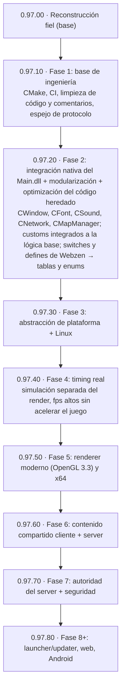
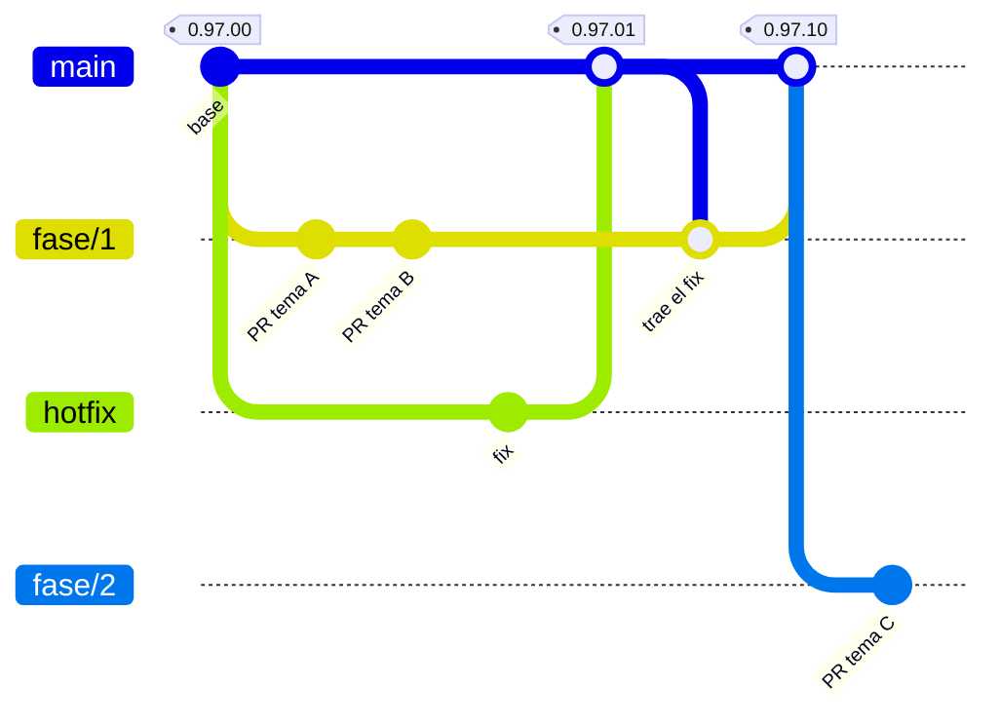

# Mu Online 0.97k — reconstrucción del código fuente

[](https://mu-linux.com/es/)

🇪🇸 Español | [🇺🇸 English](README.en.md) | [🇧🇷 Português](README.pt-BR.md)

Port a C++ del cliente **Mu Online 0.97k** (`main.exe`, MD5
`eb95ac0785e40a7ad60c9ddb5d8bef34`), reconstruido por ingeniería inversa a
partir del binario original.

El cliente compilado **se comporta igual que el binario original**: mismo flujo
de login, mismo render, mismos paquetes. No es una reescritura ni un "cliente
inspirado en": cada función es un port de su contraparte en el binario, y las
desviaciones deliberadas están documentadas en un comentario junto al código.

Sobre esa base se integraron las funciones del `Main.dll` de inyección (Fase 2)
y se agregó soporte para Linux (Fase 3).

---

## Estado

**La reconstrucción está completa.** No quedan funciones del binario sin portar.
Puede quedar algún bug latente, que aparece al ejercitar un camino poco usado y
se corrige comparando contra IDA, pero la base de la ingeniería inversa está
terminada (tag `0.97.00`).

El cliente arranca, conecta, hace login, elige personaje, entra al mundo y se
juega: terreno, personajes, NPCs y monstruos, inventario, equipo, tienda, baúl,
trade, chat, party, guild, combate, skills, efectos, eventos, sonido y música.

| Plataforma | Backend | Estado |
|---|---|---|
| Windows x86 | Win32 (el del binario original) | Completo |
| Windows x86 | SDL3 | Completo |
| Linux x86 | SDL3 | Completo; con NVIDIA conviene X11 (ver [Wayland y GPUs NVIDIA](#wayland-y-gpus-nvidia)) |

---

## Qué necesitás

- **Los assets ya están incluidos** en `bin/Client/Data/` (~209 MB: modelos
  `.bmd`, texturas `.ozj`/`.ozt`, mapas, sonidos y música). Clonás, compilás y
  arranca.
- **Un servidor.** El port está validado contra
  [MuEmu - Linux](https://github.com/EmanuelCatania/Mu-Linux-0.97k) (season
  0.97k), que es la fuente autoritativa para el formato de los paquetes. También
  se puede usar la versión de Windows,
  [MuEmu - Kayito](https://github.com/nicomuratona/MuEmu-0.97k-kayito). Cada
  Release del cliente indica con qué versión del server funciona.

---

## Compilar

Hay dos backends de plataforma, que se eligen con `MU_PLATFORM_BACKEND`:

- **`Win32`** (el default): ventana, input, sonido y red con la API de Windows,
  como el binario original. Sólo Windows.
- **`SDL3`**: lo mismo sobre SDL3, FreeType y miniaudio. Windows y Linux.

**Siempre es x86 (32 bits).** El port asume punteros de 32 bits: las direcciones
del binario original, los layouts de struct y los pools de memoria. CMake corta
la configuración si se intenta compilar en 64 bits.

### Windows (backend Win32)

Requiere **Visual Studio 2022** con el toolset de C++ para escritorio (trae
CMake). Hay dos formas equivalentes, que generan el mismo exe:

- **Visual Studio:** abrir `mu97k.sln`, elegir **Debug** o **Release** con
  plataforma **Win32**, y compilar.
- **CMake:**
  ```
  cmake -S . -B build -A Win32 -T v143
  cmake --build build --config Release
  ```
  El primer comando también genera `build/mu97k.sln`, por si querés seguir en
  Visual Studio con las carpetas de `src/` como filtros.

Salida: `bin/Client/main.exe` (más `main.map` para resolver stacks de crash).
El proyecto enlaza directo sobre `bin/Client/`, que es donde viven los assets y
`Config.ini`, así que no hay copia intermedia ni riesgo de terminar ejecutando
un binario viejo.

### Windows (backend SDL3)

Mismos requisitos que el anterior, más conexión a internet la primera vez que se
configura: SDL3, FreeType y miniaudio se descargan con `FetchContent` en
versiones fijas.

```
cmake -S . -B build-sdl3 -A Win32 -T v143 -DMU_PLATFORM_BACKEND=SDL3
cmake --build build-sdl3 --config Release
```

La salida también es `bin/Client/main.exe`, así que pisa la del backend Win32.

### Linux x86 (backend SDL3)

Hace falta Git, CMake 3.25+, Ninja, Python 3, pkg-config y GCC/G++ con soporte
`-m32`, más las bibliotecas de desarrollo de **32 bits** (también en un Linux
x64):

- **Arch** (con `[multilib]` habilitado):
  `base-devel gcc cmake ninja git python pkgconf glu wayland-protocols`, más las
  bibliotecas `lib32-*` de [Correr en Linux](#correr-en-linux), que ya incluyen
  los archivos de desarrollo.
- **Debian/Ubuntu:** `g++-multilib libc6-dev-i386 cmake ninja-build git python3
  pkg-config wayland-protocols libx11-dev:i386 libxext-dev:i386
  libxrandr-dev:i386 libxinerama-dev:i386 libxcursor-dev:i386 libxi-dev:i386
  libgl1-mesa-dev:i386 libglu1-mesa-dev:i386 libwayland-dev:i386
  libxkbcommon-dev:i386 libdecor-0-dev:i386 libasound2-dev:i386
  libpulse-dev:i386`. Ubuntu 22.04 trae CMake 3.22: instalá CMake 3.25+ antes de
  configurar (por ejemplo, en un entorno virtual de Python).
- **Fedora:** `gcc gcc-c++ cmake ninja-build git python3 pkgconf-pkg-config
  wayland-devel wayland-protocols-devel glibc-devel.i686 libstdc++-devel.i686
  mesa-libGLU-devel.i686 libglvnd-devel.i686 libX11-devel.i686
  libXext-devel.i686 libXrandr-devel.i686 libXinerama-devel.i686
  libXcursor-devel.i686 libXi-devel.i686 wayland-devel.i686
  libxkbcommon-devel.i686 libdecor-devel.i686 alsa-lib-devel.i686
  pulseaudio-libs-devel.i686`.

```sh
# PKG_CONFIG_LIBDIR tiene que apuntar a las bibliotecas de 32 bits.
export PKG_CONFIG_LIBDIR=/usr/lib32/pkgconfig:/usr/share/pkgconfig                      # Arch
# export PKG_CONFIG_LIBDIR=/usr/lib/i386-linux-gnu/pkgconfig:/usr/share/pkgconfig        # Debian / Ubuntu
# export PKG_CONFIG_LIBDIR=/usr/lib/pkgconfig:/usr/share/pkgconfig                      # Fedora

cmake -S . -B build/linux-release -G Ninja \
  -DCMAKE_TOOLCHAIN_FILE=cmake/toolchains/linux-x86.cmake \
  -DMU_PLATFORM_BACKEND=SDL3 -DMU_PLATFORM_ONLY=OFF -DCMAKE_BUILD_TYPE=Release
cmake --build build/linux-release --parallel 4
```

El ejecutable queda en `build/linux-release/bin/main` (no en `bin/Client/`, así
no se mezcla con el de Windows). Para correrlo contra los assets del repo,
apuntá `MU_ASSET_ROOT` a `bin/Client` (ver [Correr en Linux](#correr-en-linux)).

### Para colaborar

- Mientras convivan el `.sln` y CMake, un `.cpp` nuevo se agrega en el
  `.vcxproj` **y** en el `CMakeLists.txt`. El CI falla si las dos listas no
  coinciden; se puede chequear local con
  `python .github/scripts/check_cmake_sources.py`.
- Dependencias incluidas en el repo: `lib/stb` (decodifica las texturas
  `.ozj`/`.ozt` y guarda las capturas) y `lib/miniaudio` (música). Con SDL3 se
  suman SDL3 y FreeType, que se descargan al configurar.
- El CI compila las tres combinaciones (Windows Win32, Windows SDL3 y Linux
  SDL3) en Debug y Release, y arma el paquete Linux del Release.

---

## Configurar y jugar

### Apuntar a tu server

La dirección y la identidad del server van **compiladas en el cliente**, como en
MU 5.2: no hay archivo de configuración que distribuir. Están en
`src/Config/ServerConfig.h` y apuntan al server de referencia del proyecto; para
usar el tuyo, editá ese archivo y recompilá.

La dirección puede ser una IP o un nombre de host (el cliente lo resuelve por
DNS, igual que el original). Conviene un nombre: así no queda una IP pública
fija en el código y el server puede mudarse sin recompilar. Si el dominio está en
Cloudflare, el registro tiene que ir **sin proxy** ("DNS only"): el proxy sólo
deja pasar tráfico web y corta las conexiones del juego.

```cpp
constexpr char           ConnectServerIP[]   = "mu.server-pups.space";
constexpr unsigned short ConnectServerPort   = 44405;   // 0 = sin ConnectServer
constexpr char           GameServerIP[]      = "mu.server-pups.space";
constexpr unsigned short GameServerPort      = 55901;
constexpr char           CustomerName[]      = "MuLinux";
constexpr char           ServerSerial[]      = "TbYehR2hFUPBKgZj";
constexpr char           ClientVersion[]     = "0.97.11";
```

**Direcciones.** Con `ConnectServerPort` distinto de 0 se usa el flujo
ConnectServer: el cliente pide la lista real (`F4/02`), el server contesta con
nombres y ocupación, y al elegir uno el `F4/03` redirige al GameServer; si el
ConnectServer no responde, se conecta al GameServer. Con `0` se conecta directo
al GameServer y el select-server muestra una entrada fija.

> El select-server aparece **siempre**, incluso apuntando directo al GameServer:
> es una pantalla del flujo original, no un indicio de que estés llegando al
> ConnectServer.

**Identidad del server.** Los tres valores tienen que coincidir con los del
GameServer (`MuServer/GameServer/DATA/GameServerInfo - StartUp.dat`). Si alguno
no coincide, el cliente **conecta pero no entra**, y sin ningún mensaje útil:

| Valor | De dónde sale | Qué pasa si no coincide |
|---|---|---|
| `CustomerName` | `CustomerName=` del `.dat` | El cliente conecta, desencripta basura y se queda en *"conectando al GameServer"* para siempre |
| `ServerSerial` | `ServerSerial=` del `.dat` | Igual que arriba, **y además** el login devuelve *"versión incorrecta"* |
| `ClientVersion` | `ServerVersion=` del `.dat` | Login rechazado con *"versión incorrecta"* |

`CustomerName` y `ServerSerial` alimentan la clave de encriptación, que el
GameServer deriva de los dos combinados (`GameServer/HackCheck.cpp::InitHackCheck`).
`ServerSerial` cumple doble función: entra en esa derivación y además el server
lo compara byte a byte en el login. `ClientVersion` acepta `0.97.11` o `09711`.

**Para diagnosticar**, `debug.log` registra al arrancar la dirección usada y la
clave derivada:

```
ServerConfig: ConnectServer=mu.server-pups.space:44405 GameServer=mu.server-pups.space:55901 version='09711'
MuEmu: InitKeys CustomerName='MuLinux' Serial='TbYehR2hFUPBKgZj' -> EncDecKey1=0xC2 EncDecKey2=0x01 (xor=0xC2 add=0xC2)
```

Si el cliente se queda colgado conectando, esa línea es lo primero que hay que
mirar: comparala con el `CustomerName` del server.

### Opciones del jugador

Las preferencias se leen de **`Config.ini`**, con las mismas secciones y claves
que usaba el `Main.dll` de inyección, así sirve el `Config.ini` que ya tengas.
En Windows está en `bin/Client/Config.ini`; en Linux, en
`~/.local/share/mu97k/Config.ini`. La mayoría también se cambia desde el menú de
opciones del juego, que las guarda en el mismo archivo.

En Windows, si una clave no está en `Config.ini` manda el registro (donde el
0.97k original guardaba lo que configuraba el launcher oficial) y, si tampoco
está ahí, el default del binario. Lo que se aplicó queda en `debug.log` (línea
`Config.ini: ...`).

| Clave | Default | Notas |
|---|---|---|
| `[Window] WindowMode` | — (desviación) | `1` = en ventana, `0` = pantalla completa. El 0.97k sólo corre fullscreen y busca un modo de video de 16 bits que en Windows 10/11 no existe. |
| `[Window] Borderless` | — (desviación) | `1` = sin barra de título ni borde. Sólo aplica en modo ventana. |
| `[Window] Resolution` | `0` (640x480) | Índices del DLL: `0` 640x480, `1` 800x600, `2` 1024x768, `3` 1280x1024, `4` 1280x720, `5` 1366x768, `6` 1600x900, `7` 1920x1080. Ojo: el `4` no es el mismo del registro (ahí es 1600x1200). |
| `[Window] RenderDecoupled` | `1` | Desacopla el render; `0` vuelve al límite de 40 ms. La simulación sigue a 25 Hz. |
| `[Window] FpsLimit` | `60` | Límite de FPS con desacople activo; `0` = sin límite. Opciones → Pantalla permite 25/30/60/120/144/sin límite. |
| `[Window] VSync` | `0` | Sincronización vertical. Desacople, VSync y FPS se aplican en caliente y se guardan desde Opciones → Pantalla. VSync también limita «sin límite» al refresco de la pantalla. F12 muestra u oculta los FPS a la izquierda dentro del juego, incluso en pantalla completa; comienza oculto. |
| `[Sound] EnableSound` | `1` | Efectos de sonido. |
| `[Sound] EnableMusic` | `0` (apagada) | El `Config.ini` del repo la trae en `1`. El tema del login es `Data\Music\MuTheme.mp3`, que el pack no trae (como en el original). |
| `[Sound] SoundLevel`, `MusicLevel` | — (desviación) | Volumen de `0` (mudo) a `9` (volumen original); como en el DLL, cada nivel son 6,25 dB. |
| `[User] Username` | — | Precarga el campo de usuario del login. |
| `[Language] LangSelection` | — (`Text.bmd`, que acá es la variante en español) | Idioma de la interfaz: `Eng`, `Spn` o `Por`. Elige entre los `Text_*.bmd` y `Dialog_*.bmd` de `Data/Local/`. Los nombres de items, skills y quests están en inglés y no tienen variante. |
| `[MiniMap] Alpha`, `ZoomLevel` | `10`, `0` | Transparencia (`3` a `10`) y zoom (`0` a `6`) del minimapa. |
| `[Antilag] Delete…` | `0` | Apagan partes del render para equipos lentos: `DeleteShadows`, `DeleteObjects`, `DeleteFloor`, `DeleteSkills`, `DeleteStaticEffects`, `DeleteDynamicEffects`, `DeleteWings`, `DeleteHealthBar`, `DeleteInterface`, `DeleteWeather`, `DeleteGlow`. |
| `[Font] FontName`, `FontHeight`, `FontBold`, `FontItalic`, `FontCharset`, `FontWidth`, `FontUnderline`, `FontQuality`, `FontStrikeOut` | Arial, alto según la resolución | Como el DLL: alto fijo (tope 25) y la fuente grande al doble. El `Config.ini` del repo trae Verdana 13. Si se borra la sección `[Font]` completa, el cliente vuelve a la fuente original. |

### Correr en Windows

Ejecutar `bin/Client/main.exe`.

### Correr en Linux

El CI arma un paquete del cliente Linux (artefacto `mu97k-linux-release`: el
`.tar.gz`, su SHA256 y el inventario de bibliotecas). Trae `main`, `Data`,
licencias, README y `launch.sh`; no lleva el `Config.ini` del desarrollador.

El ejecutable es **ELF32 con SSE2**, compilado sobre Ubuntu 22.04 (no usa
símbolos de glibc posteriores a 2.35). SDL3, FreeType y miniaudio van enlazados
estáticamente; OpenGL, glibc y las bibliotecas del escritorio son del sistema y
tienen que estar en **32 bits**, incluso en un Linux x64:

```sh
# Arch ([multilib] habilitado)
sudo pacman -S --needed lib32-glibc lib32-gcc-libs lib32-glu lib32-libglvnd \
  lib32-libx11 lib32-libxext lib32-libxrandr lib32-libxcursor lib32-libxi \
  lib32-wayland lib32-libxkbcommon lib32-libdecor lib32-alsa-lib lib32-libpulse
# Intel/AMD: lib32-mesa. NVIDIA: lib32-nvidia-utils de la misma versión que el driver.

# Debian 12 / Ubuntu 22.04+
sudo dpkg --add-architecture i386
sudo apt-get update
sudo apt-get install libc6:i386 libstdc++6:i386 libgcc-s1:i386 \
  libglu1-mesa:i386 libgl1:i386 libegl1:i386 libgl1-mesa-dri:i386 \
  libx11-6:i386 libxext6:i386 libxrandr2:i386 libxcursor1:i386 libxi6:i386 \
  libwayland-client0:i386 libwayland-cursor0:i386 libwayland-egl1:i386 \
  libxkbcommon0:i386 libdecor-0-0:i386 libdecor-0-plugin-1-cairo:i386 libpulse0:i386
# ALSA: libasound2:i386 (Debian 12 / Ubuntu 22.04), libasound2t64:i386 (Ubuntu 24.04+).

# Fedora
sudo dnf install glibc.i686 libstdc++.i686 libgcc.i686 mesa-libGLU.i686 \
  libglvnd-glx.i686 libglvnd-egl.i686 mesa-dri-drivers.i686 \
  libX11.i686 libXext.i686 libXrandr.i686 libXcursor.i686 libXi.i686 \
  wayland.i686 libxkbcommon.i686 libdecor.i686 alsa-lib.i686 pulseaudio-libs.i686
```

Descomprimí el `.tar.gz` en una partición Linux (en NTFS se pierden los permisos
de ejecución) y ejecutá `./launch.sh` desde una terminal, sin sudo. La
configuración, las capturas y el `debug.log` se guardan en
`${XDG_DATA_HOME:-$HOME/.local/share}/mu97k`; `MU_CLIENT_ROOT` permite elegir
otro directorio. El primer arranque crea una configuración en ventana a
1024×768 y nunca pisa preferencias existentes.

Para leer los assets desde otra carpeta sin copiarlos (por ejemplo, un disco
NTFS o el `bin/Client` del repo), apuntá `MU_ASSET_ROOT` a la carpeta **que
contiene `Data`**:

```sh
MU_ASSET_ROOT='/run/media/usuario/HDD/ruta/Client' ./launch.sh
```

Sin `SDL_VIDEODRIVER`, una sesión Wayland prueba Wayland y después
X11/XWayland; el backend elegido y el renderer OpenGL quedan en stderr al
arrancar (`Backend de video: …` y `OpenGL: vendor | renderer | versión`). Para
forzar uno: `SDL_VIDEODRIVER=x11 ./launch.sh` o `SDL_VIDEODRIVER=wayland
./launch.sh`.

Otros detalles de Linux:

- `lib32-libdecor` da las decoraciones de ventana del lado del cliente. Sin él,
  un compositor que no decora del lado del server puede mostrar la ventana sin
  marco.
- En HiDPI se conserva la resolución lógica del juego y el compositor escala la
  imagen, que puede verse menos nítida.
- El IME usa la entrada de texto de SDL/Wayland, limitada al repertorio
  Windows-1252 del juego; no muestra el indicador IMM de Windows.
- La captura de pantalla es con **Impr Pant**. En KDE la toma Spectacle antes
  de que llegue al juego.

### Wayland y GPUs NVIDIA

El cliente es de 32 bits, y con NVIDIA eso tiene dos consecuencias en Wayland
nativo (encontradas en Arch, KDE Plasma, RTX 3080 Ti, driver 615):

- **Sin la plataforma EGL Wayland de 32 bits, Wayland usa render por software.**
  NVIDIA sólo distribuye `egl-wayland` para x64. Sin
  `libnvidia-egl-wayland.so.1` en `/usr/lib32`, el contexto GL de Wayland cae en
  Mesa `llvmpipe`: 24 fps, efectos de skill en cuadrados blancos y negros
  transparentes. El cliente lo detecta al arrancar (`Renderer por software en
  wayland`) y pasa solo a X11/XWayland, donde GLX sí usa la GPU.
- **Con esa plataforma instalada, Wayland nativo funciona pero rinde mucho
  menos.** El driver EGL de NVIDIA en 32 bits resuelve variables thread-local con
  `__tls_get_addr` en cada llamada GL, y el cliente dibuja en modo inmediato
  (`glVertex`/`glTexCoord` por vértice, como el 0.97k). Medido en el mismo punto
  del juego: 4,7 ms por frame con X11/GLX contra 70-85 ms con Wayland/EGL, o sea
  25 fps contra 11-17. `__GL_SYNC_TO_VBLANK` y `__GL_MaxFramesAllowed` no lo
  cambian. No se corrige desde el cliente: se resuelve con el renderer moderno o
  el paso a x64 de la hoja de ruta.

En el segundo caso el cliente **no** cae solo a X11, porque el renderer es
acelerado. **Con NVIDIA, corré el cliente en X11:**

```sh
SDL_VIDEODRIVER=x11 ./launch.sh
```

Wayland nativo queda para GPUs con Mesa (Intel/AMD), cuyo EGL de 32 bits no
tiene este problema.

`egl-wayland` de 32 bits no está en los repositorios oficiales de Arch. El
paquete `lib32-egl-wayland` de AUR suele estar atrasado y exige la misma versión
que `egl-wayland`; instalarlo con un helper puede bajar el de 64 bits. Si lo
querés para probar, compilá el PKGBUILD cambiando `pkgver` a la versión de tu
`egl-wayland`, y recompilalo cada vez que actualices el driver.

---

## Cómo agregar items custom

Con el `Main.dll` de inyección, un item custom se agregaba de los dos lados: el
server lo definía en su `Item.txt`, y el cliente necesitaba un `item.bmd`
regenerado más los `.txt` del `Encoder` (`CustomItem.txt`, `CustomGlow.txt`,
etc.) empaquetados en `ClientInfo.bmd`. Si cliente y server no coincidían, el
item se veía mal o el server lo rechazaba.

Ahora **el server es la única fuente**. Al loguearse, le manda al cliente un
catálogo con todas las definiciones (items, monstruos, efectos, pets). El
cliente **sólo necesita los archivos del modelo** (`.bmd` y texturas) dentro de
`bin/Client/Data`. No hay que regenerar `item.bmd` ni tocar código.

Los `.txt` del `Encoder` del DLL se siguen leyendo desde
`Data/Custom/Encoder` del server, así que una carpeta de customs armada para el
DLL funciona sin convertir nada.

### Índices: el rango clásico y el extendido

Cada sección de items (espadas, hachas, …, joyas) tiene en el 0.97k **32
índices** (0 a 31). Además, cada sección acepta índices **32 a 511**: son los
items *agregados*. En el protocolo viajan con 13 bits (el item usa 7 bytes en
vez de 5), así que entran sin pisar ningún item vanilla.

Un agregado necesita decir **qué item vanilla imita** (columna *Comportamiento*):
eso decide la lógica que el 0.97k tiene escrita por tipo de item (si es un arco
y gasta flechas, si es un ala, si es una joya, qué opciones excellent puede
tener). Todo lo demás —nombre, stats, tamaño, modelo, brillo, efectos— sale de
su propia fila.

### Ejemplo 1: la Knight Blade, como se hacía con el DLL

El item está dentro del rango clásico (`0,20`); el modelo y el brillo se
definen en el `Encoder`:

```
// Data/Custom/Encoder/CustomItem.txt
00,020		22		"Sword21"		// Knight Blade

// Data/Custom/Encoder/CustomGlow.txt
00,020		191	165	127		// Knight Blade
```

Assets en el cliente: `bin/Client/Data/Item/Custom/20/` (`sword21.bmd` y sus
texturas).

### Ejemplo 2: la Crimson Knight Blade, fuera del rango clásico

El mismo modelo como item agregado (`0,32`), todo en una fila de
`Data/Item/Item.txt`. Al final de las columnas de siempre se agregan:
comportamiento, carpeta y nombre del modelo, y el color del brillo (RGB):

```
32	0	22	1	4	1	1	0	"Crimson Knight Blade"	...	00,020	"Item\Custom\20\"	"Sword21"	255	40	40
```

Se comporta como la Knight Blade (`00,020`), usa el modelo `Sword21` y brilla en
rojo. Comando de prueba: `/make 0 32`.

### Ejemplo 3: el set Great Dragon

Cinco piezas en el índice `21` de las secciones 7 a 11, con el modelo definido
en el `CustomItem.txt` del `Encoder` (como en el DLL):

```
07,021		0		"HelmMale22"		// Great Dragon Helm
08,021		0		"ArmorMale22"		// Great Dragon Armor
09,021		0		"PantMale22"		// Great Dragon Pant
10,021		0		"GloveMale22"		// Great Dragon Glove
11,021		0		"BootMale22"		// Great Dragon Boot
```

Assets en el cliente: `bin/Client/Data/Player/Custom/21/`. Las mismas piezas
también se pueden definir sin el `Encoder`, con las columnas de modelo en
`Item.txt` (`"Player\Custom\21\" "HelmMale22"`).

### Ejemplo 4: efectos propios y pose en el inventario

`Data/Custom/Items/<sección>_<índice>.json` agrega a un item (custom o vanilla)
su pose en el inventario y efectos que el cliente dibuja sobre los huesos del
modelo. Por ejemplo, unas alas con los destellos de las Wings of Illusion del
5.2:

```json
{
  "item": "12,032",
  "effects": [
    { "on": "equipped", "type": "sprite", "texture": "Effect/Flare.jpg",
      "bones": [5, 6, 7, 8, 18, 19], "color": [0.5, 0.0, 0.0], "scale": 0.6,
      "pulse": { "speed": 0.002, "scale": 0.2, "color": 0.4 } },
    { "on": "equipped", "type": "particle", "particle": 1230,
      "bones": [13, 31], "chance": 2, "color": [0.8, 0.8, 0.3], "scale": 0.5 }
  ]
}
```

En el repo del server hay un caso real: `Data/Custom/Items/03_000.json` corrige
la posición del Light Spear (vanilla) en su casilla, con la corrección del 5.2.

### Ejemplo 5: un pet custom (Pet Rudolph)

El Rudolph del 5.2 como pet que da vueltas alrededor del jugador y levanta el
zen cercano. Va en un índice alto (`13,400`) a propósito, para que sirva de
ejemplo del rango extendido. Son cuatro archivos, todos incluidos en los repos:

| Dónde | Archivo | Qué define |
|---|---|---|
| cliente | `bin/Client/Data/Item/Custom/Rudolph/` | el modelo `xmas_deer.bmd` y sus texturas |
| server | `Data/Item/Item.txt` | la fila del item: `Slot` 8 (helper), comportamiento `*` (no imita a ningún pet vanilla) y el modelo |
| server | `Data/Custom/Items/13_400.json` | la pose en el inventario |
| server | `Data/Custom/Pets/13_400.json` | cómo se mueve y qué hace |

```json
{
  "item": "13,400",
  "blendMesh": 0,
  "movement": { "type": "orbit", "radius": 50, "period": 4000, "height": 20 },
  "abilities": [ { "type": "pickup", "what": "zen", "range": 3, "interval": 1000, "delay": 1500 } ]
}
```

El cliente dibuja el movimiento; las habilidades (levantar el zen) las ejecuta
el server, que es el que decide. Comando de prueba: `/make 13 400`.

### Ejemplo 6: un monstruo custom (Karane)

Como en el DLL, con `Data/Custom/Encoder/CustomMonster.txt` (índice, tipo
`0`=NPC `1`=monstruo, dorado, escala, carpeta y modelo):

```
152		1		1		2.0		"Monster\\Karane\\"		"Karane"		// Karane
```

O directamente en `Data/Monster/Monster.txt`, con las mismas columnas al final
de la fila del monstruo:

```
152	0	"Karane"	...	0	0	1	1	2.0	"Monster\Karane\"	"Karane"
```

Assets en el cliente: `bin/Client/Data/Monster/Karane/`.

### Referencia

Columnas opcionales al final de cada fila de `Item.txt` (`*` = sin valor):

| Columna | Ejemplo | Qué hace |
|---|---|---|
| Comportamiento | `00,020` | vanilla que imita en la lógica |
| Carpeta y modelo | `"Item\Custom\20\" "Sword21"` | modelo en el inventario, el suelo y el personaje |
| Brillo | `255 40 40` | color del brillo por nivel |
| Carpeta y modelo puesto | `"Item\Custom\FenrirMount\" "fenril_black"` | sólo si el item se ve distinto puesto (una montura) |
| Gate | `22` | para pergaminos: lleva siempre a ese gate |

Los JSON de `Data/Custom/Items` también aceptan `"tooltip"`: hasta 6 líneas
propias debajo del nombre del item, como texto (`"Zen picker"`) o con color
(`{ "text": "Zen picker", "color": "gold" }`; colores: `white`, `blue`, `red`,
`gold`, `green`, `darkred`, `purple`, `darkblue`, `darkgold`).

Para alas custom, `Data/Item/CustomWing.txt` agrega las constantes de defensa y
daño. Los JSON de `Data/Custom/Items` y `Data/Custom/Pets` se validan al
arrancar el server: un archivo con errores se descarta entero y el motivo queda
en `GameServer/LOG`.

---

## Estructura

```
mu97k-src/
├── mu97k.sln            solución de VS2022 (backend Win32)
├── mu97k.vcxproj        proyecto (Win32)
├── CMakeLists.txt       build de las tres combinaciones (Win32, SDL3 Windows, SDL3 Linux)
├── cmake/               módulos de CMake y el toolchain de Linux x86
├── lib/stb/             decodifica las texturas .ozj/.ozt y guarda las capturas
├── lib/miniaudio/       reproduce la música
└── src/
    ├── WinMain.cpp      punto de entrada + loop de mensajes
    ├── Platform/        interfaces de plataforma y sus backends (Win32/, SDL3/, Posix/)
    ├── globals.{h,cpp}  estado global; los DAT identificados conservan trazabilidad IDA
    ├── functions.h      declaraciones compartidas y procedencia IDA de símbolos renombrados
    ├── structs.h        layouts de struct verificados contra IDA
    ├── ghidra_compat.h  macros que el decompile da por existentes (qmemcpy, LODWORD, ...)
    │
    ├── Combat/  Config/  Core/    Entity/  Game/     GameGuard/ Input/ Item/
    ├── Local/   Math/    Model/   Monster/ Net/       Party/     Path/  Physics/
    └── Render/  Scene/   Sound/   Terrain/ Trade/     UI/        Util/
```

Los módulos agrupan por responsabilidad. La dirección en el binario sigue
siendo una pista importante para verificar una función o resolver un símbolo,
pero no determina la ubicación del código portado.

---

## Hoja de ruta

El tag `0.97.00` cierra la etapa de reconstrucción fiel: el cliente se comporta
como el binario original. A partir de ahí el trabajo sigue por fases, y cada fase
cerrada es una versión.



Los números de cada fase son la versión prevista al cerrarla; el alcance de cada
una puede ajustarse en el camino.

### Versionado

Las versiones son `0.97.FH`, siempre de dos dígitos: **F** es la fase y **H** el
hotfix.

| Tag | Qué es |
|---|---|
| `0.97.00` | base de la reconstrucción fiel |
| `0.97.01`, `0.97.02`… | correcciones sobre la base |
| `0.97.10` | cierre de la Fase 1 |
| `0.97.11`, `0.97.12`… | correcciones sobre la Fase 1 |
| `0.97.20` | cierre de la Fase 2, y así sucesivamente |

El cliente y el [server](https://github.com/EmanuelCatania/Mu-Linux-0.97k) usan la
misma numeración, pero el server sólo recibe un tag nuevo cuando cambia. Cada
Release del cliente indica con qué tag del server funciona (por ejemplo, el
cliente `0.97.10` funciona con el server `0.97.00`). Cada Season tendrá su propia
línea (`0.99.FH`, …).

### Ramas



- `main` sólo recibe cierres de fase y correcciones; cada merge lleva su tag y su
  Release.
- Cada fase se trabaja en `fase/N`. Las ramas de tema (`fix/…`, `feat/…`, `chore/…`)
  salen de `fase/N` y vuelven por PR.
- Una corrección sobre una versión publicada sale del tag afectado, se mergea a
  `main` con su nuevo tag y también a la fase en curso.

---

## Licencia

MIT — ver [LICENSE](LICENSE).

La licencia cubre **el código**: todo lo que está bajo `src/`.

**No** cubre los assets de `bin/Client/Data/`, que son copyright de WebZen Inc.

Las bibliotecas de terceros mantienen sus propias licencias: stb y miniaudio
(dominio público / MIT-0), y SDL3 (zlib) y FreeType (FreeType License) en el
backend SDL3. El paquete Linux las incluye en `licenses/`.

---

## Apéndice: la reconstrucción

Esta parte es para quien quiera verificar un port contra el binario o seguir la
historia de la ingeniería inversa. No hace falta para compilar ni para jugar.

### El binario original

El `main.exe` original no está en el repo: sólo hace falta para decompilarlo y
comparar un port contra él. Sale de cualquier distribución del cliente 0.97k.
Verificá el MD5 (`eb95ac0785e40a7ad60c9ddb5d8bef34`) antes de comparar
direcciones: hay muchas variantes parcheadas dando vueltas y no coinciden.

### La regla principal: fiel al binario

El orden de autoridad para resolver cualquier duda:

1. **IDA / el binario original.** Es la verdad. Si el decompile dice algo raro,
   probablemente el decompile tenga razón y nuestra intuición no.
2. **El servidor MuEmu**, para todo lo que sea formato de paquetes.
3. **El DLL de inyección**, como segunda referencia de comportamiento.
4. **El source de Mu Online 5.2**, sólo como apoyo semántico y de nomenclatura
   cuando el contexto actual lo permite. No se copia implementación ni se
   incorpora comportamiento de 5.2: la UI, las definiciones y las features
   pueden diferir de 0.97k.

Lo que no está en ninguna de esas fuentes no se inventa. Si hace falta una
desviación (porque un camino del original es inalcanzable, o depende de algo
que todavía no está portado), se implementa **y se documenta en un comentario
ahí mismo**, explicando qué hace el original y por qué nos apartamos.

Lo único que se saltea deliberadamente es el ruido anti-tamper: las
operaciones de hash-table intercaladas, los bloques inalcanzables y el
scrambling XOR de la versión protegida. No son lógica de juego.

### Nombres y comentarios en el código

El código está en español. Los símbolos que ya pudieron identificarse se nombran
por responsabilidad; su definición canónica conserva un comentario
`// IDA: <nombre> (<dirección>)` para mantener la trazabilidad con el binario.

Los `FUN_*` y `DAT_*` que todavía aparecen en el código no son, por sí solos,
deuda de renombrado. Algunos describen infraestructura, CRT, GameGuard, layouts
binarios, pools o compatibilidad; otros requieren investigación antes de poder
recibir un nombre semántico seguro. Tampoco son deuda los aliases o bridges ABI
que quedan en `functions.h`/`globals.h`: mantienen el contrato original de los
ports que los usan.

Los comentarios describen **el código actual**: la referencia a IDA, el layout
de un struct o paquete, las desviaciones vigentes respecto del binario y las
advertencias que evitan romper algo. La historia de cómo se llegó a un fix
(fechas, sondas, intentos descartados, lo que hacía el port viejo) va en el
mensaje del commit. Los comentarios de desarrollo que estaban en el código y los
decompilados de IDA que nunca se activaron (antes en `src/stubs_IDA_ports.cpp`)
quedaron archivados en `docs/` del tag `0.97.21`; el texto original completo
sigue en el tag `0.97.00`.

### Trampas conocidas

Estas costaron sesiones enteras de depuración. Todas volvieron a aparecer más de
una vez.

**1. Símbolos duplicados.** El mismo nombre definido dos veces: un stub viejo y
el port real. C++ puede aceptarlo como sobrecarga si las firmas difieren, y
entonces cada llamador resuelve a una copia distinta. Síntoma típico: un valor
se corrompe y no aparece ningún escritor que lo explique. Antes de auditar
cualquier función, confirmá que estás leyendo **la copia que se compila** —
no una dentro de `#if 0`. Corolario: una sonda de diagnóstico puesta en código
muerto da cero resultados, y ese silencio parece evidencia de que no hay bug.

**2. Locales que Ghidra separó.** El decompile emite como variables sueltas lo
que en el frame original era un bloque contiguo, y el código las recorre como
si lo fueran (`&local_XX` de un escalar pasado como `vec3`). El compilador no
garantiza ese layout. Síntoma: la primera componente sale bien y el resto es
basura (valores de ~1e9). Se arregla reconstruyendo el frame como un array
contiguo y mapeando los nombres por offset.

**3. Campos enteros leídos como float.** Ghidra tipa el slot como `float*` y
entonces *todo* acceso sale como float, incluidos los campos que son enteros o
punteros. `(float)(uintptr_t)ptr` convierte numéricamente lo que había que
reinterpretar por bits. Síntoma: no es un crash, es funcionalidad que
simplemente no ocurre — comparaciones que nunca dan verdadero, punteros en
cero, contadores clavados. Pista: valores de ~1e9 que leídos como bits dan
floats chicos y razonables. Dentro de un mismo archivo suelen convivir accesos
correctos y rotos; esa mezcla es la señal.

**4. Padding de structs en los paquetes.** El servidor manda structs de C con
su padding de alineación. Leer los campos por offset "lógico" en vez del real
devuelve basura convincente. Ya mordió en los stats, en la lista de guild y en
los números de daño.

**5. Las etiquetas de los offsets mienten.** Varios campos de la struct de
entidad estuvieron mal etiquetados durante meses (`+0x1BC` no son flags de
movimiento: es la clase del personaje; `+0x34E` no es "muerto": es SafeZone).
Antes de confiar en el nombre de un offset, buscá quién lo **escribe** en el
binario.

**6. Nombres de funciones parecidos con efectos opuestos.** El caso recurrente
es la familia de estado de OpenGL: `EnableAlphaTest` (0x511680),
`EnableAlphaBlend` (0x511710, aditivo) y `DisableTexture` (0x511590, que apaga
el texturizado). Confundirlas pinta cuadrados blancos sobre medio frame,
porque el estado de GL queda pegado y contamina todo lo que se dibuje después.

**7. Cotas y limpiezas inventadas.** Guards que el binario no tiene y que en vez
de recortar **descartan la entrada entera**. Apareció de los dos lados: en los
handlers de red (`count > 30` tiraba los 41 monstruos de un viewport; el síntoma
se leía como bug de spawn, con una cascada de `key not found` en el log) y en el
input tick (un `else` que al bloquear el debounce hacía
`MouseLButtonPush = 0; MouseLButton = 0;`, o sea perdía el click: había que
clickear varias veces para caminar). Regla: cualquier `= 0` o `clear` que el port
agregue en el camino de *«todavía no se puede»* es sospechoso — el binario casi
siempre deja el estado pendiente para el próximo tick.

### Desviaciones de protocolo

Están documentadas en el código, pero conviene saberlas si se apunta a otro
servidor:

- **`C3:1E` (duration skill) se manda con 11 bytes, no 9.** El 0.97k vanilla no
  incluye `index[]`, pero `CGDurationSkillAttackRecv` de MuEmu lo lee siempre
  (`SkillManager.cpp:2047`): con 9 bytes el server toma esos dos bytes de fuera
  del paquete y el skill le pega a otra entidad. El DLL de inyección hace lo
  mismo (`CPatchs::SendRequestMagicContinue`).
- **Triple Shot manda el byte `angle`.** El server arma el cono con `angle`, no
  con `dir` (`SkillManager.cpp:1185`).
- **F3/12 al entrar al mundo.** Sin ese ACK el server deja `RegenOk` en 1 y
  rechaza todo `/move` posterior además de no mandar las entidades del mapa.
