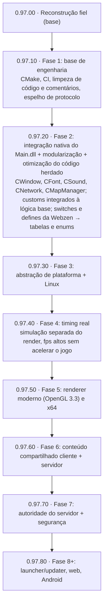
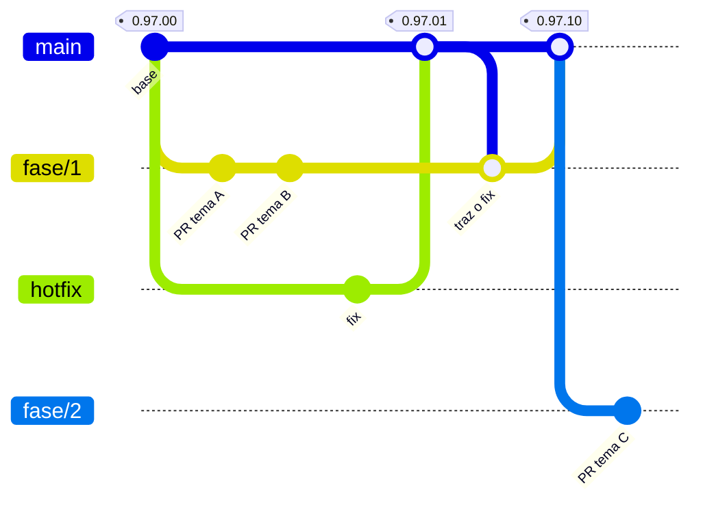

# Mu Online 0.97k — reconstrução do código-fonte

[](https://mu-linux.com/es/)

[🇪🇸 Español](README.md) | [🇺🇸 English](README.en.md) | 🇧🇷 Português

Port em C++ do cliente **Mu Online 0.97k** (`main.exe`, MD5
`eb95ac0785e40a7ad60c9ddb5d8bef34`), reconstruído por engenharia reversa a
partir do binário original.

O cliente compilado **se comporta igual ao binário original**: mesmo fluxo de
login, mesmo render, mesmos pacotes. Não é uma reescrita nem um "cliente
inspirado em": cada função é um port da sua contraparte no binário, e os desvios
deliberados estão documentados em um comentário ao lado do código.

Sobre essa base foram integradas as funções do `Main.dll` de injeção (Fase 2) e
foi adicionado suporte a Linux (Fase 3).

---

## Estado

**A reconstrução está completa.** Não restam funções do binário sem portar. Pode
aparecer algum bug latente ao exercitar um caminho pouco usado, que se corrige
comparando com o IDA, mas a base da engenharia reversa está terminada (tag
`0.97.00`).

O cliente inicia, conecta, faz login, escolhe personagem, entra no mundo e é
jogável: terreno, personagens, NPCs e monstros, inventário, equipamento, loja,
baú, trade, chat, party, guild, combate, skills, efeitos, eventos, som e música.

| Plataforma | Backend | Estado |
|---|---|---|
| Windows x86 | Win32 (o do binário original) | Completo |
| Windows x86 | SDL3 | Completo |
| Linux x86 | SDL3 | Completo; com NVIDIA, prefira X11 (veja [Wayland e GPUs NVIDIA](#wayland-e-gpus-nvidia)) |

---

## O que você precisa

- **Os assets já estão incluídos** em `bin/Client/Data/` (~209 MB: modelos
  `.bmd`, texturas `.ozj`/`.ozt`, mapas, sons e música). Clone, compile e rode.
- **Um servidor.** O port está validado contra
  [MuEmu - Linux](https://github.com/EmanuelCatania/Mu-Linux-0.97k) (season
  0.97k), que é a fonte autoritativa para o formato dos pacotes. A versão para
  Windows, [MuEmu - Kayito](https://github.com/nicomuratona/MuEmu-0.97k-kayito),
  também funciona. Cada Release do cliente indica com qual versão do servidor
  funciona.

---

## Compilar

Há dois backends de plataforma, escolhidos com `MU_PLATFORM_BACKEND`:

- **`Win32`** (o padrão): janela, input, som e rede com a API do Windows, como o
  binário original. Só Windows.
- **`SDL3`**: o mesmo sobre SDL3, FreeType e miniaudio. Windows e Linux.

**É sempre x86 (32 bits).** O port assume ponteiros de 32 bits: os endereços do
binário original, os layouts de struct e os pools de memória. O CMake interrompe
a configuração se você tentar compilar em 64 bits.

### Windows (backend Win32)

Requer o **Visual Studio 2022** com o toolset de C++ para desktop (que traz o
CMake). Há duas formas equivalentes, que geram o mesmo exe:

- **Visual Studio:** abrir `mu97k.sln`, escolher **Debug** ou **Release** com a
  plataforma **Win32**, e compilar.
- **CMake:**
  ```
  cmake -S . -B build -A Win32 -T v143
  cmake --build build --config Release
  ```
  O primeiro comando também gera `build/mu97k.sln`, caso você queira continuar no
  Visual Studio com as pastas de `src/` como filtros.

Saída: `bin/Client/main.exe` (mais `main.map` para resolver stacks de crash). O
projeto linka direto em `bin/Client/`, que é onde ficam os assets e o
`Config.ini`, então não há cópia intermediária nem risco de acabar rodando um
binário velho.

### Windows (backend SDL3)

Os mesmos requisitos, mais conexão à internet na primeira configuração: SDL3,
FreeType e miniaudio são baixados com `FetchContent` em versões fixas.

```
cmake -S . -B build-sdl3 -A Win32 -T v143 -DMU_PLATFORM_BACKEND=SDL3
cmake --build build-sdl3 --config Release
```

A saída também é `bin/Client/main.exe`, então sobrescreve a do backend Win32.

### Linux x86 (backend SDL3)

Você precisa de Git, CMake 3.25+, Ninja, Python 3, pkg-config e GCC/G++ com
suporte a `-m32`, mais as bibliotecas de desenvolvimento de **32 bits** (também
em um Linux x64):

- **Arch** (com `[multilib]` habilitado):
  `base-devel gcc cmake ninja git python pkgconf glu wayland-protocols`, mais as
  bibliotecas `lib32-*` de [Rodar no Linux](#rodar-no-linux), que já incluem os
  arquivos de desenvolvimento.
- **Debian/Ubuntu:** `g++-multilib libc6-dev-i386 cmake ninja-build git python3
  pkg-config wayland-protocols libx11-dev:i386 libxext-dev:i386
  libxrandr-dev:i386 libxinerama-dev:i386 libxcursor-dev:i386 libxi-dev:i386
  libgl1-mesa-dev:i386 libglu1-mesa-dev:i386 libwayland-dev:i386
  libxkbcommon-dev:i386 libdecor-0-dev:i386 libasound2-dev:i386
  libpulse-dev:i386`. O Ubuntu 22.04 traz o CMake 3.22: instale o CMake 3.25+
  antes de configurar (por exemplo, em um ambiente virtual de Python).
- **Fedora:** `gcc gcc-c++ cmake ninja-build git python3 pkgconf-pkg-config
  wayland-devel wayland-protocols-devel glibc-devel.i686 libstdc++-devel.i686
  mesa-libGLU-devel.i686 libglvnd-devel.i686 libX11-devel.i686
  libXext-devel.i686 libXrandr-devel.i686 libXinerama-devel.i686
  libXcursor-devel.i686 libXi-devel.i686 wayland-devel.i686
  libxkbcommon-devel.i686 libdecor-devel.i686 alsa-lib-devel.i686
  pulseaudio-libs-devel.i686`.

```sh
# PKG_CONFIG_LIBDIR tem que apontar para as bibliotecas de 32 bits.
export PKG_CONFIG_LIBDIR=/usr/lib32/pkgconfig:/usr/share/pkgconfig                      # Arch
# export PKG_CONFIG_LIBDIR=/usr/lib/i386-linux-gnu/pkgconfig:/usr/share/pkgconfig        # Debian / Ubuntu
# export PKG_CONFIG_LIBDIR=/usr/lib/pkgconfig:/usr/share/pkgconfig                      # Fedora

cmake -S . -B build/linux-release -G Ninja \
  -DCMAKE_TOOLCHAIN_FILE=cmake/toolchains/linux-x86.cmake \
  -DMU_PLATFORM_BACKEND=SDL3 -DMU_PLATFORM_ONLY=OFF -DCMAKE_BUILD_TYPE=Release
cmake --build build/linux-release --parallel 4
```

O executável fica em `build/linux-release/bin/main` (não em `bin/Client/`, para
não se misturar com o do Windows). Para rodá-lo com os assets do repo, aponte
`MU_ASSET_ROOT` para `bin/Client` (veja [Rodar no Linux](#rodar-no-linux)).

### Para colaborar

- Enquanto o `.sln` e o CMake convivem, um `.cpp` novo é adicionado no
  `.vcxproj` **e** no `CMakeLists.txt`. O CI falha se as duas listas não
  coincidirem; dá para conferir localmente com
  `python .github/scripts/check_cmake_sources.py`.
- Dependências incluídas no repo: `lib/stb` (decodifica as texturas `.ozj`/`.ozt`
  e salva as capturas) e `lib/miniaudio` (música). Com SDL3 entram também SDL3 e
  FreeType, baixados na configuração.
- O CI compila as três combinações (Windows Win32, Windows SDL3 e Linux SDL3) em
  Debug e Release, e monta o pacote Linux do Release.

---

## Configurar e jogar

### Apontar para o seu servidor

O endereço e a identidade do servidor são **compilados no cliente**, como no
MU 5.2: não há arquivo de configuração para distribuir. Ficam em
`src/Config/ServerConfig.h` e apontam para o servidor de referência do projeto;
para usar o seu, edite esse arquivo e recompile.

O endereço pode ser um IP ou um nome de host (o cliente o resolve por DNS, igual
ao original). Um nome é melhor: assim não fica um IP público fixo no código e o
servidor pode mudar sem recompilar. Se o domínio estiver no Cloudflare, o
registro tem que ficar **sem proxy** ("DNS only"): o proxy só deixa passar
tráfego web e corta as conexões do jogo.

```cpp
constexpr char           ConnectServerIP[]   = "mu.server-pups.space";
constexpr unsigned short ConnectServerPort   = 44405;   // 0 = sem ConnectServer
constexpr char           GameServerIP[]      = "mu.server-pups.space";
constexpr unsigned short GameServerPort      = 55901;
constexpr char           CustomerName[]      = "MuLinux";
constexpr char           ServerSerial[]      = "TbYehR2hFUPBKgZj";
constexpr char           ClientVersion[]     = "0.97.11";
```

**Endereços.** Com `ConnectServerPort` diferente de 0 é usado o fluxo
ConnectServer: o cliente pede a lista real (`F4/02`), o servidor responde com
nomes e ocupação, e ao escolher um o `F4/03` redireciona para o GameServer; se o
ConnectServer não responder, conecta ao GameServer. Com `0` conecta direto ao
GameServer e o select-server mostra uma entrada fixa.

> O select-server aparece **sempre**, mesmo apontando direto para o GameServer:
> é uma tela do fluxo original, não um sinal de que você está chegando ao
> ConnectServer.

**Identidade do servidor.** Os três valores têm que coincidir com os do
GameServer (`MuServer/GameServer/DATA/GameServerInfo - StartUp.dat`). Se algum
não coincidir, o cliente **conecta mas não entra**, e sem nenhuma mensagem útil:

| Valor | De onde vem | O que acontece se não coincidir |
|---|---|---|
| `CustomerName` | `CustomerName=` do `.dat` | O cliente conecta, descriptografa lixo e fica em *"conectando ao GameServer"* para sempre |
| `ServerSerial` | `ServerSerial=` do `.dat` | O mesmo que acima, **e além disso** o login devolve *"versão incorreta"* |
| `ClientVersion` | `ServerVersion=` do `.dat` | Login rejeitado com *"versão incorreta"* |

`CustomerName` e `ServerSerial` alimentam a chave de criptografia, que o
GameServer deriva dos dois combinados (`GameServer/HackCheck.cpp::InitHackCheck`).
`ServerSerial` tem dupla função: entra nessa derivação e o servidor também o
compara byte a byte no login. `ClientVersion` aceita `0.97.11` ou `09711`.

**Para diagnosticar**, o `debug.log` registra ao iniciar o endereço usado e a
chave derivada:

```
ServerConfig: ConnectServer=mu.server-pups.space:44405 GameServer=mu.server-pups.space:55901 version='09711'
MuEmu: InitKeys CustomerName='MuLinux' Serial='TbYehR2hFUPBKgZj' -> EncDecKey1=0xC2 EncDecKey2=0x01 (xor=0xC2 add=0xC2)
```

Se o cliente travar conectando, essa linha é a primeira coisa a olhar: compare-a
com o `CustomerName` do servidor.

### Opções do jogador

As preferências são lidas do **`Config.ini`**, com as mesmas seções e chaves que
o `Main.dll` de injeção usava, então o `Config.ini` que você já tem serve. No
Windows fica em `bin/Client/Config.ini`; no Linux, em
`~/.local/share/mu97k/Config.ini`. A maioria também pode ser mudada pelo menu de
opções do jogo, que as salva no mesmo arquivo.

No Windows, se uma chave não estiver no `Config.ini` vale o registro (onde o
0.97k original guardava o que o launcher oficial configurava) e, se também não
estiver lá, o padrão do binário. O que foi aplicado fica no `debug.log` (linha
`Config.ini: ...`).

| Chave | Padrão | Notas |
|---|---|---|
| `[Window] WindowMode` | — (desvio) | `1` = em janela, `0` = tela cheia. O 0.97k só roda em tela cheia e procura um modo de vídeo de 16 bits que não existe no Windows 10/11. |
| `[Window] Borderless` | — (desvio) | `1` = sem barra de título nem borda. Só vale em modo janela. |
| `[Window] Resolution` | `0` (640x480) | Índices do DLL: `0` 640x480, `1` 800x600, `2` 1024x768, `3` 1280x1024, `4` 1280x720, `5` 1366x768, `6` 1600x900, `7` 1920x1080. Atenção: o `4` não é o mesmo do registro (lá é 1600x1200). |
| `[Sound] EnableSound` | `1` | Efeitos sonoros. |
| `[Sound] EnableMusic` | `0` (desligada) | O `Config.ini` do repo a traz em `1`. O tema do login é `Data\Music\MuTheme.mp3`, que o pack não traz (como no original). |
| `[Sound] SoundLevel`, `MusicLevel` | — (desvio) | Volume de `0` (mudo) a `9` (volume original); como no DLL, cada nível são 6,25 dB. |
| `[User] Username` | — | Preenche o campo de usuário do login. |
| `[Language] LangSelection` | — (`Text.bmd`, que aqui é a variante em espanhol) | Idioma da interface: `Eng`, `Spn` ou `Por`. Escolhe entre os `Text_*.bmd` e `Dialog_*.bmd` de `Data/Local/`. Os nomes de itens, skills e quests estão em inglês e não têm variante. |
| `[MiniMap] Alpha`, `ZoomLevel` | `10`, `0` | Transparência (`3` a `10`) e zoom (`0` a `6`) do minimapa. |
| `[Antilag] Delete…` | `0` | Desligam partes do render para máquinas lentas: `DeleteShadows`, `DeleteObjects`, `DeleteFloor`, `DeleteSkills`, `DeleteStaticEffects`, `DeleteDynamicEffects`, `DeleteWings`, `DeleteHealthBar`, `DeleteInterface`, `DeleteWeather`, `DeleteGlow`. |
| `[Font] FontName`, `FontHeight`, `FontBold`, `FontItalic`, `FontCharset`, `FontWidth`, `FontUnderline`, `FontQuality`, `FontStrikeOut` | Arial, altura conforme a resolução | Como o DLL: altura fixa (máximo 25) e a fonte grande com o dobro. O `Config.ini` do repo traz Verdana 13. Se a seção `[Font]` inteira for apagada, o cliente volta à fonte original. |

### Rodar no Windows

Execute `bin/Client/main.exe`.

### Rodar no Linux

O CI monta um pacote do cliente Linux (artefato `mu97k-linux-release`: o
`.tar.gz`, seu SHA256 e o inventário de bibliotecas). Traz `main`, `Data`,
licenças, README e `launch.sh`; não leva o `Config.ini` do desenvolvedor.

O executável é **ELF32 com SSE2**, compilado sobre o Ubuntu 22.04 (não usa
símbolos da glibc posteriores à 2.35). SDL3, FreeType e miniaudio são linkados
estaticamente; OpenGL, glibc e as bibliotecas do desktop são do sistema e têm
que estar em **32 bits**, mesmo em um Linux x64:

```sh
# Arch ([multilib] habilitado)
sudo pacman -S --needed lib32-glibc lib32-gcc-libs lib32-glu lib32-libglvnd \
  lib32-libx11 lib32-libxext lib32-libxrandr lib32-libxcursor lib32-libxi \
  lib32-wayland lib32-libxkbcommon lib32-libdecor lib32-alsa-lib lib32-libpulse
# Intel/AMD: lib32-mesa. NVIDIA: lib32-nvidia-utils da mesma versão do driver.

# Debian 12 / Ubuntu 22.04+
sudo dpkg --add-architecture i386
sudo apt-get update
sudo apt-get install libc6:i386 libstdc++6:i386 libgcc-s1:i386 \
  libglu1-mesa:i386 libgl1:i386 libegl1:i386 libgl1-mesa-dri:i386 \
  libx11-6:i386 libxext6:i386 libxrandr2:i386 libxcursor1:i386 libxi6:i386 \
  libwayland-client0:i386 libwayland-cursor0:i386 libwayland-egl1:i386 \
  libxkbcommon0:i386 libdecor-0-0:i386 libdecor-0-plugin-1-cairo:i386 libpulse0:i386
# ALSA: libasound2:i386 (Debian 12 / Ubuntu 22.04), libasound2t64:i386 (Ubuntu 24.04+).

# Fedora
sudo dnf install glibc.i686 libstdc++.i686 libgcc.i686 mesa-libGLU.i686 \
  libglvnd-glx.i686 libglvnd-egl.i686 mesa-dri-drivers.i686 \
  libX11.i686 libXext.i686 libXrandr.i686 libXcursor.i686 libXi.i686 \
  wayland.i686 libxkbcommon.i686 libdecor.i686 alsa-lib.i686 pulseaudio-libs.i686
```

Descompacte o `.tar.gz` em uma partição Linux (em NTFS as permissões de execução
se perdem) e execute `./launch.sh` a partir de um terminal, sem sudo. A
configuração, as capturas e o `debug.log` ficam em
`${XDG_DATA_HOME:-$HOME/.local/share}/mu97k`; `MU_CLIENT_ROOT` permite escolher
outro diretório. A primeira execução cria uma configuração em janela a 1024×768 e
nunca sobrescreve preferências existentes.

Para ler os assets de outra pasta sem copiá-los (por exemplo, um disco NTFS ou o
`bin/Client` do repo), aponte `MU_ASSET_ROOT` para a pasta **que contém `Data`**:

```sh
MU_ASSET_ROOT='/run/media/usuario/HDD/caminho/Client' ./launch.sh
```

Sem `SDL_VIDEODRIVER`, uma sessão Wayland tenta Wayland e depois X11/XWayland; o
backend escolhido e o renderer OpenGL aparecem no stderr ao iniciar
(`Backend de video: …` e `OpenGL: vendor | renderer | versión`). Para forçar um:
`SDL_VIDEODRIVER=x11 ./launch.sh` ou `SDL_VIDEODRIVER=wayland ./launch.sh`.

Outros detalhes do Linux:

- `lib32-libdecor` fornece as decorações de janela do lado do cliente. Sem ele,
  um compositor que não decora do lado do servidor pode mostrar a janela sem
  moldura.
- Em HiDPI a resolução lógica do jogo é mantida e o compositor escala a imagem,
  que pode ficar menos nítida.
- O IME usa a entrada de texto do SDL/Wayland, limitada ao repertório
  Windows-1252 do jogo; não mostra o indicador IMM do Windows.
- A captura de tela é com **Print Screen**. No KDE, o Spectacle pega a tecla
  antes que chegue ao jogo.

### Wayland e GPUs NVIDIA

O cliente é de 32 bits, e com NVIDIA isso tem duas consequências no Wayland
nativo (encontradas no Arch, KDE Plasma, RTX 3080 Ti, driver 615):

- **Sem a plataforma EGL Wayland de 32 bits, o Wayland renderiza por software.**
  A NVIDIA só distribui o `egl-wayland` para x64. Sem
  `libnvidia-egl-wayland.so.1` em `/usr/lib32`, o contexto GL do Wayland cai no
  Mesa `llvmpipe`: 24 fps, efeitos de skill em quadrados brancos e pretos
  transparentes. O cliente detecta isso ao iniciar (`Renderer por software en
  wayland`) e passa sozinho para X11/XWayland, onde o GLX usa a GPU.
- **Com essa plataforma instalada, o Wayland nativo funciona, mas rende muito
  menos.** O driver EGL da NVIDIA em 32 bits resolve variáveis thread-local com
  `__tls_get_addr` em cada chamada GL, e o cliente desenha em modo imediato
  (`glVertex`/`glTexCoord` por vértice, como o 0.97k). Medido no mesmo ponto do
  jogo: 4,7 ms por frame com X11/GLX contra 70-85 ms com Wayland/EGL, ou seja
  25 fps contra 11-17. `__GL_SYNC_TO_VBLANK` e `__GL_MaxFramesAllowed` não mudam
  isso. Não se corrige pelo cliente: resolve-se com o renderer moderno ou com a
  passagem para x64 do roteiro.

No segundo caso o cliente **não** cai sozinho para X11, porque o renderer é
acelerado. **Com NVIDIA, rode o cliente em X11:**

```sh
SDL_VIDEODRIVER=x11 ./launch.sh
```

O Wayland nativo fica para GPUs com Mesa (Intel/AMD), cujo EGL de 32 bits não tem
esse problema.

O `egl-wayland` de 32 bits não está nos repositórios oficiais do Arch. O pacote
`lib32-egl-wayland` do AUR costuma estar atrasado e exige a mesma versão do
`egl-wayland`; instalá-lo com um helper pode rebaixar o de 64 bits. Se você o
quiser para testar, compile o PKGBUILD mudando `pkgver` para a versão do seu
`egl-wayland`, e recompile-o toda vez que atualizar o driver.

---

## Como adicionar itens custom

Com o `Main.dll` de injeção, um item custom era adicionado dos dois lados: o
server o definia no seu `Item.txt`, e o cliente precisava de um `item.bmd`
regerado mais os `.txt` do `Encoder` (`CustomItem.txt`, `CustomGlow.txt`, etc.)
empacotados no `ClientInfo.bmd`. Se cliente e server não batiam, o item
aparecia errado ou o server o rejeitava.

Agora **o server é a única fonte**. No login ele manda ao cliente um catálogo
com todas as definições (itens, monstros, efeitos, pets). O cliente **só
precisa dos arquivos do modelo** (`.bmd` e texturas) dentro de
`bin/Client/Data`. Não é preciso regerar o `item.bmd` nem mexer no código.

Os `.txt` do `Encoder` do DLL continuam sendo lidos de `Data/Custom/Encoder`
do server, então uma pasta de customs feita para o DLL funciona sem converter
nada.

### Índices: a faixa clássica e a estendida

No 0.97k cada seção de itens (espadas, machados, …, joias) tem **32 índices**
(0 a 31). Além disso, cada seção aceita índices **32 a 511**: são os itens
*adicionados*. No protocolo eles usam 13 bits (o item ocupa 7 bytes em vez de
5), então nunca colidem com um item vanilla.

Um item adicionado precisa dizer **qual item vanilla ele imita** (coluna
*Comportamento*): isso decide a lógica que o 0.97k tem escrita por tipo de item
(se é um arco e gasta flechas, se é uma asa, uma joia, quais opções excellent
pode ter). Todo o resto —nome, stats, tamanho, modelo, brilho, efeitos— vem da
sua própria linha.

### Exemplo 1: a Knight Blade, do jeito do DLL

O item fica dentro da faixa clássica (`0,20`); modelo e brilho são definidos no
`Encoder`:

```
// Data/Custom/Encoder/CustomItem.txt
00,020		22		"Sword21"		// Knight Blade

// Data/Custom/Encoder/CustomGlow.txt
00,020		191	165	127		// Knight Blade
```

Assets no cliente: `bin/Client/Data/Item/Custom/20/` (`sword21.bmd` e suas
texturas).

### Exemplo 2: a Crimson Knight Blade, fora da faixa clássica

O mesmo modelo como item adicionado (`0,32`), tudo em uma linha de
`Data/Item/Item.txt`. Depois das colunas de sempre vêm: comportamento, pasta e
nome do modelo, e a cor do brilho (RGB):

```
32	0	22	1	4	1	1	0	"Crimson Knight Blade"	...	00,020	"Item\Custom\20\"	"Sword21"	255	40	40
```

Se comporta como a Knight Blade (`00,020`), usa o modelo `Sword21` e brilha em
vermelho. Comando de teste: `/make 0 32`.

### Exemplo 3: o set Great Dragon

Cinco peças no índice `21` das seções 7 a 11, com o modelo definido no
`CustomItem.txt` do `Encoder` (como no DLL):

```
07,021		0		"HelmMale22"		// Great Dragon Helm
08,021		0		"ArmorMale22"		// Great Dragon Armor
09,021		0		"PantMale22"		// Great Dragon Pant
10,021		0		"GloveMale22"		// Great Dragon Glove
11,021		0		"BootMale22"		// Great Dragon Boot
```

Assets no cliente: `bin/Client/Data/Player/Custom/21/`. As mesmas peças também
podem ser definidas sem o `Encoder`, com as colunas de modelo no `Item.txt`
(`"Player\Custom\21\" "HelmMale22"`).

### Exemplo 4: efeitos próprios e pose no inventário

`Data/Custom/Items/<seção>_<índice>.json` dá a um item (custom ou vanilla) sua
pose no inventário e efeitos que o cliente desenha sobre os ossos do modelo.
Por exemplo, asas com os brilhos das Wings of Illusion do 5.2:

```json
{
  "item": "12,032",
  "effects": [
    { "on": "equipped", "type": "sprite", "texture": "Effect/Flare.jpg",
      "bones": [5, 6, 7, 8, 18, 19], "color": [0.5, 0.0, 0.0], "scale": 0.6,
      "pulse": { "speed": 0.002, "scale": 0.2, "color": 0.4 } },
    { "on": "equipped", "type": "particle", "particle": 1230,
      "bones": [13, 31], "chance": 2, "color": [0.8, 0.8, 0.3], "scale": 0.5 }
  ]
}
```

No repo do server há um caso real: `Data/Custom/Items/03_000.json` corrige a
posição da Light Spear (vanilla) na sua casa do inventário, com a correção do
5.2.

### Exemplo 5: um pet custom (Pet Rudolph)

O Rudolph do 5.2 como pet que dá voltas ao redor do jogador e pega o zen
próximo. Ele usa um índice alto (`13,400`) de propósito, como exemplo da faixa
estendida. São quatro arquivos, todos incluídos nos repos:

| Onde | Arquivo | O que define |
|---|---|---|
| cliente | `bin/Client/Data/Item/Custom/Rudolph/` | o modelo `xmas_deer.bmd` e suas texturas |
| server | `Data/Item/Item.txt` | a linha do item: `Slot` 8 (helper), comportamento `*` (não imita nenhum pet vanilla) e o modelo |
| server | `Data/Custom/Items/13_400.json` | a pose no inventário |
| server | `Data/Custom/Pets/13_400.json` | como se move e o que faz |

```json
{
  "item": "13,400",
  "blendMesh": 0,
  "movement": { "type": "orbit", "radius": 50, "period": 4000, "height": 20 },
  "abilities": [ { "type": "pickup", "what": "zen", "range": 3, "interval": 1000, "delay": 1500 } ]
}
```

O cliente desenha o movimento; as habilidades (pegar o zen) são executadas pelo
server, que é quem decide. Comando de teste: `/make 13 400`.

### Exemplo 6: um monstro custom (Karane)

Do jeito do DLL, com `Data/Custom/Encoder/CustomMonster.txt` (índice, tipo
`0`=NPC `1`=monstro, dourado, escala, pasta e modelo):

```
152		1		1		2.0		"Monster\\Karane\\"		"Karane"		// Karane
```

Ou direto no `Data/Monster/Monster.txt`, com as mesmas colunas no fim da linha
do monstro:

```
152	0	"Karane"	...	0	0	1	1	2.0	"Monster\Karane\"	"Karane"
```

Assets no cliente: `bin/Client/Data/Monster/Karane/`.

### Referência

Colunas opcionais no fim de cada linha do `Item.txt` (`*` = sem valor):

| Coluna | Exemplo | O que faz |
|---|---|---|
| Comportamento | `00,020` | item vanilla que imita na lógica |
| Pasta e modelo | `"Item\Custom\20\" "Sword21"` | modelo no inventário, no chão e no personagem |
| Brilho | `255 40 40` | cor do brilho por nível |
| Pasta e modelo equipado | `"Item\Custom\FenrirMount\" "fenril_black"` | só se o item aparece diferente equipado (uma montaria) |
| Gate | `22` | para pergaminhos: leva sempre a esse gate |

Os JSON de `Data/Custom/Items` também aceitam `"tooltip"`: até 6 linhas
próprias abaixo do nome do item, como texto (`"Zen picker"`) ou com cor
(`{ "text": "Zen picker", "color": "gold" }`; cores: `white`, `blue`, `red`,
`gold`, `green`, `darkred`, `purple`, `darkblue`, `darkgold`).

Para asas custom, `Data/Item/CustomWing.txt` adiciona as constantes de defesa e
dano. Os JSON de `Data/Custom/Items` e `Data/Custom/Pets` são validados quando o
server inicia: um arquivo com erros é descartado inteiro e o motivo vai para o
`GameServer/LOG`.

---

## Estrutura

```
mu97k-src/
├── mu97k.sln            solução do VS2022 (backend Win32)
├── mu97k.vcxproj        projeto (Win32)
├── CMakeLists.txt       build das três combinações (Win32, SDL3 Windows, SDL3 Linux)
├── cmake/               módulos do CMake e o toolchain de Linux x86
├── lib/stb/             decodifica as texturas .ozj/.ozt e salva as capturas
├── lib/miniaudio/       toca a música
└── src/
    ├── WinMain.cpp      ponto de entrada + loop de mensagens
    ├── Platform/        interfaces de plataforma e seus backends (Win32/, SDL3/, Posix/)
    ├── globals.{h,cpp}  estado global; os DATs identificados mantêm rastreabilidade IDA
    ├── functions.h      declarações compartilhadas e procedência IDA dos símbolos renomeados
    ├── structs.h        layouts de struct verificados contra o IDA
    ├── ghidra_compat.h  macros que o decompile dá como existentes (qmemcpy, LODWORD, ...)
    │
    ├── Combat/  Config/  Core/    Entity/  Game/     GameGuard/ Input/ Item/
    ├── Local/   Math/    Model/   Monster/ Net/       Party/     Path/  Physics/
    └── Render/  Scene/   Sound/   Terrain/ Trade/     UI/        Util/
```

Os módulos agrupam por responsabilidade. O endereço no binário continua sendo
uma pista importante para verificar uma função ou resolver um símbolo, mas não
determina onde fica o código portado.

---

## Roteiro

A tag `0.97.00` fecha a etapa de reconstrução fiel: o cliente se comporta como o
binário original. A partir daí o trabalho segue por fases, e cada fase fechada é
uma versão.



Os números de cada fase são a versão prevista ao fechá-la; o escopo de cada uma
pode ser ajustado no caminho.

### Versionamento

As versões são `0.97.FH`, sempre com dois dígitos: **F** é a fase e **H** o
hotfix.

| Tag | O que é |
|---|---|
| `0.97.00` | base da reconstrução fiel |
| `0.97.01`, `0.97.02`… | correções sobre a base |
| `0.97.10` | fechamento da Fase 1 |
| `0.97.11`, `0.97.12`… | correções sobre a Fase 1 |
| `0.97.20` | fechamento da Fase 2, e assim por diante |

O cliente e o [servidor](https://github.com/EmanuelCatania/Mu-Linux-0.97k) usam
a mesma numeração, mas o servidor só recebe uma tag nova quando muda. Cada
Release do cliente indica com qual tag do servidor funciona (por exemplo, o
cliente `0.97.10` funciona com o servidor `0.97.00`). Cada Season terá sua
própria linha (`0.99.FH`, …).

### Branches



- `main` só recebe fechamentos de fase e correções; cada merge leva sua tag e
  seu Release.
- Cada fase é trabalhada em `fase/N`. As branches de tema (`fix/…`, `feat/…`,
  `chore/…`) saem de `fase/N` e voltam por PR.
- Uma correção sobre uma versão publicada sai da tag afetada, é mergeada em
  `main` com sua nova tag e também na fase em andamento.

---

## Licença

MIT — veja [LICENSE](LICENSE).

A licença cobre **o código**: tudo o que está sob `src/`.

**Não** cobre os assets de `bin/Client/Data/`, que são copyright da WebZen Inc.

As bibliotecas de terceiros mantêm suas próprias licenças: stb e miniaudio
(domínio público / MIT-0), e SDL3 (zlib) e FreeType (FreeType License) no backend
SDL3. O pacote Linux as inclui em `licenses/`.

---

## Apêndice: a reconstrução

Esta parte é para quem quiser verificar um port contra o binário ou acompanhar a
história da engenharia reversa. Não é necessária para compilar nem para jogar.

### O binário original

O `main.exe` original não está no repo: só é necessário para descompilá-lo e
comparar um port com ele. Vem de qualquer distribuição do cliente 0.97k. Confira
o MD5 (`eb95ac0785e40a7ad60c9ddb5d8bef34`) antes de comparar endereços: há muitas
variantes modificadas circulando e elas não coincidem.

### A regra principal: fiel ao binário

A ordem de autoridade para resolver qualquer dúvida:

1. **IDA / o binário original.** É a verdade. Se o decompile diz algo estranho,
   provavelmente o decompile tem razão e a nossa intuição não.
2. **O servidor MuEmu**, para tudo o que é formato de pacotes.
3. **O DLL de injeção**, como segunda referência de comportamento.
4. **O source do Mu Online 5.2**, só como apoio semântico e de nomenclatura
   quando o contexto atual permite. Não se copia implementação nem se incorpora
   comportamento do 5.2: a UI, as definições e as features podem diferir do
   0.97k.

O que não está em nenhuma dessas fontes não se inventa. Se for preciso um desvio
(porque um caminho do original é inalcançável, ou depende de algo ainda não
portado), ele é implementado **e documentado em um comentário ali mesmo**,
explicando o que o original faz e por que nos afastamos.

A única coisa pulada de propósito é o ruído anti-tamper: as operações de
hash-table intercaladas, os blocos inalcançáveis e o scrambling XOR da versão
protegida. Não são lógica de jogo.

### Nomes e comentários no código

**O código e os comentários estão em espanhol.** Os símbolos que já puderam ser
identificados são nomeados por responsabilidade; a definição canônica de cada um
mantém um comentário `// IDA: <nome> (<endereço>)` para preservar a
rastreabilidade com o binário.

Os `FUN_*` e `DAT_*` que ainda aparecem no código não são, por si só, dívida de
renomeação. Alguns descrevem infraestrutura, CRT, GameGuard, layouts binários,
pools ou compatibilidade; outros exigem investigação antes de poder receber um
nome semântico seguro. Também não são dívida os aliases e bridges de ABI que
restam em `functions.h`/`globals.h`: eles mantêm o contrato original dos ports
que os usam.

Os comentários descrevem **o código atual**: a referência ao IDA, o layout de um
struct ou pacote, os desvios vigentes em relação ao binário e os avisos que
evitam quebrar algo. A história de como se chegou a um fix (datas, sondas,
tentativas descartadas, o que o port antigo fazia) vai na mensagem do commit. Os
comentários de desenvolvimento que estavam no código e os decompilados do IDA
que nunca foram ativados (antes em `src/stubs_IDA_ports.cpp`) estão arquivados
em `docs/` da tag `0.97.21`; o texto original completo continua na tag `0.97.00`.

### Armadilhas conhecidas

Estas custaram sessões inteiras de depuração. Todas voltaram a aparecer mais de
uma vez.

**1. Símbolos duplicados.** O mesmo nome definido duas vezes: um stub antigo e o
port real. O C++ pode aceitá-lo como sobrecarga se as assinaturas diferirem, e
então cada chamador resolve para uma cópia diferente. Sintoma típico: um valor
se corrompe e não aparece nenhum escritor que o explique. Antes de auditar
qualquer função, confirme que você está lendo **a cópia que é compilada** — não
uma dentro de `#if 0`. Corolário: uma sonda de diagnóstico colocada em código
morto dá zero resultados, e esse silêncio parece evidência de que não há bug.

**2. Locais que o Ghidra separou.** O decompile emite como variáveis soltas o que
no frame original era um bloco contíguo, e o código as percorre como se fossem
(`&local_XX` de um escalar passado como `vec3`). O compilador não garante esse
layout. Sintoma: a primeira componente sai certa e o resto é lixo (valores de
~1e9). Corrige-se reconstruindo o frame como um array contíguo e mapeando os
nomes por offset.

**3. Campos inteiros lidos como float.** O Ghidra tipa o slot como `float*` e
então *todo* acesso sai como float, inclusive os campos que são inteiros ou
ponteiros. `(float)(uintptr_t)ptr` converte numericamente o que era para
reinterpretar pelos bits. Sintoma: não é um crash, é funcionalidade que
simplesmente não acontece — comparações que nunca dão verdadeiro, ponteiros
zerados, contadores travados. Pista: valores de ~1e9 que, lidos como bits, dão
floats pequenos e razoáveis. Num mesmo arquivo costumam conviver acessos
corretos e quebrados; essa mistura é o sinal.

**4. Padding de structs nos pacotes.** O servidor manda structs de C com seu
padding de alinhamento. Ler os campos por offset "lógico" em vez do real devolve
lixo convincente. Já mordeu nos stats, na lista da guild e nos números de dano.

**5. Os rótulos dos offsets mentem.** Vários campos do struct de entidade
ficaram mal rotulados durante meses (`+0x1BC` não são flags de movimento: é a
classe do personagem; `+0x34E` não é "morto": é SafeZone). Antes de confiar no
nome de um offset, procure quem o **escreve** no binário.

**6. Nomes de funções parecidos com efeitos opostos.** O caso recorrente é a
família de estado do OpenGL: `EnableAlphaTest` (0x511680), `EnableAlphaBlend`
(0x511710, aditivo) e `DisableTexture` (0x511590, que desliga o texturizado).
Confundi-las pinta quadrados brancos sobre meio frame, porque o estado do GL fica
grudado e contamina tudo o que é desenhado depois.

**7. Limites e limpezas inventados.** Guards que o binário não tem e que, em vez
de recortar, **descartam a entrada inteira**. Apareceu dos dois lados: nos
handlers de rede (`count > 30` jogava fora os 41 monstros de um viewport; o
sintoma parecia bug de spawn, com uma cascata de `key not found` no log) e no
input tick (um `else` que, ao bloquear o debounce, fazia
`MouseLButtonPush = 0; MouseLButton = 0;`, ou seja perdia o clique: era preciso
clicar várias vezes para andar). Regra: qualquer `= 0` ou `clear` que o port
adicione no caminho de *«ainda não dá»* é suspeito — o binário quase sempre
deixa o estado pendente para o próximo tick.

### Desvios de protocolo

Estão documentados no código, mas convém conhecê-los se você apontar para outro
servidor:

- **`C3:1E` (duration skill) é enviado com 11 bytes, não 9.** O 0.97k vanilla
  não inclui `index[]`, mas o `CGDurationSkillAttackRecv` do MuEmu sempre o lê
  (`SkillManager.cpp:2047`): com 9 bytes o servidor pega esses dois bytes de fora
  do pacote e a skill acerta outra entidade. O DLL de injeção faz o mesmo
  (`CPatchs::SendRequestMagicContinue`).
- **O Triple Shot envia o byte `angle`.** O servidor monta o cone com `angle`, não
  com `dir` (`SkillManager.cpp:1185`).
- **F3/12 ao entrar no mundo.** Sem esse ACK o servidor deixa `RegenOk` em 1 e
  rejeita todo `/move` posterior, além de não mandar as entidades do mapa.
